# PI - EasyCar (Luiz, Barbiana e Yandra)

API REST de uma locadora de carros: clientes, carros, aluguéis e multas, com acesso
por grupos (Funcionários e Clientes). Feita com Django + Django REST Framework.

## Banco de dados

- **SQLite** para desenvolvimento e testes automatizados
- **PostgreSQL 17** para produção (via Docker)
- Acesso a dados com o **ORM do Django** (`locadora/models.py`); regras de negócio com transação em `locadora/services.py`

## Como rodar

```bash
python -m venv .venv
source .venv/bin/activate          # Windows: .venv\Scripts\Activate.ps1
pip install -r requirements-dev.txt
cp .env.example .env               # Windows: Copy-Item .env.example .env
python manage.py migrate
python manage.py runserver         # http://localhost:8000/api/  |  docs: /api/docs/
pytest                             # testes
docker compose up --build          # API + PostgreSQL, igual à produção
```

## Dashboard integrado

O dashboard e a API usam o mesmo projeto Django, os modelos de [`locadora/models.py`](./locadora/models.py) e o mesmo banco configurado em `config/settings.py`. As páginas reaproveitam os templates e arquivos estáticos em `dashboard_locadora/core/`, mas não usam mais o banco isolado daquela pasta.

- Painel da equipe: `/` (login de funcionário)
- Frota: `/carros/` (dados consultados no banco principal)
- Cadastro de veículo: `/carros/novo/` (funcionários; inclui chassi, placa, ano e diária)
- Clientes: `/clientes/` (funcionários; cria usuário e perfil com CNH, telefone e endereço)
- Novo aluguel: `/alugueis/novo/` (registra pela camada de serviços da API e atualiza o status do carro)
- Taxas: `/taxas-atraso/`
- API e documentação: `/api/` e `/api/docs/`
- Administração: `/admin/`

Para executar no Windows, na raiz deste repositório:

```powershell
python -m venv .venv
.\.venv\Scripts\Activate.ps1
pip install -r requirements-dev.txt
Copy-Item .env.example .env
python manage.py migrate
python manage.py createsuperuser
python manage.py runserver
```

Use um superusuário ou adicione um usuário ao grupo `Funcionários` para acessar o painel, cadastrar clientes e veículos e registrar aluguéis. Para cadastrar um cliente, o painel cria um usuário no grupo `Clientes` e seu perfil no mesmo banco.

Na primeira migração, são criadas até 20 unidades de demonstração, identificadas na frota e no painel; elas não são apresentadas como veículos reais pela API. Se já houver uma unidade real de um modelo, ela é priorizada na frota.

O campo `chassi` é validado com 17 caracteres e é mostrado apenas para funcionários na API. Placa, ano, diária e status continuam compartilhados entre as páginas e os endpoints.

## Documentação

Esta seção documenta a camada de **banco de dados** do EasyCar: como ela é organizada,
como roda em desenvolvimento/testes (SQLite) e em produção (PostgreSQL), como o
Docker empacota a aplicação e quais padrões de código seguimos.

## Índice

| Documento | Conteúdo |
|---|---|
| [Docker](#docker) | Como o `Dockerfile` e o `docker-compose.yml` funcionam, linha por linha |
| [Banco de testes](#banco-de-testes-sqlite) | Banco de testes (SQLite), versões, como rodar e **o que cada teste verifica** |
| [Banco de produção](#banco-de-produção-postgresql) | Banco de produção (PostgreSQL), modelo de dados, transações, backup |
| [CI/CD](#cicd-github-actions) | Pipeline do GitHub Actions: lint → testes (SQLite + PostgreSQL) → imagem Docker |
| [Padrões de código](#padrões-de-código) | Arquitetura em camadas, boas práticas do ORM, type hints, nomes, erros |
| [Alterações da branch](#alterações-da-branch-featurebanco-de-dados) | O que mudou na branch `feature/banco-de-dados` e por quê |
| [Pendências](#pendências) | O que ainda falta (do banco e de outras partes do projeto) |
| [openapi.yml](docs/openapi.yml) | Especificação OpenAPI da API (gerada pelo drf-spectacular) |
| [Referências](#referências-bibliográficas) | Referências bibliográficas de tudo que usamos no projeto |

## Visão geral

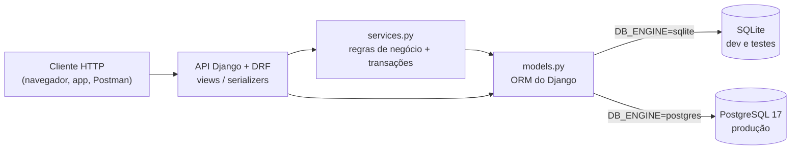

O acesso ao banco é feito pelo **ORM do Django**: escrevemos Python
(`Carro.objects.filter(...)`) e o Django gera o SQL certo para cada banco. Quem
escolhe qual banco usar é a variável de ambiente `DB_ENGINE`. O código é o mesmo
nos dois.

## Versões utilizadas

Todas fixadas em `requirements.txt` / `requirements-dev.txt` (versões estáveis):

| Tecnologia | Versão | Para quê |
|---|---|---|
| Python | 3.13 (Docker/CI) | Linguagem (também testado em 3.14) |
| Django | 5.2.19 (LTS, suporte até abril/2028) | Framework web |
| Django REST Framework | 3.18.3 | API REST |
| drf-spectacular | 0.30.0 | Documentação OpenAPI/Swagger |
| python-dotenv | 1.2.4 | Lê o arquivo `.env` |
| psycopg (binary) | 3.3.8 | Driver do PostgreSQL |
| gunicorn | 26.2.0 | Servidor de produção |
| whitenoise | 6.12.0 | Serve arquivos estáticos (admin, Swagger) |
| PostgreSQL | 17 (imagem `postgres:17-alpine`) | Banco de produção |
| SQLite | embutido no Python | Banco de desenvolvimento/testes |
| pytest / pytest-django / pytest-cov | 9.2.0 / 4.14.0 / 7.1.0 | Testes e cobertura |
| ruff | 0.17.4 | Lint |

> Por que Django 5.2 e não 6.x? A 5.2 é **LTS** (Long Term Support): recebe correções
> de segurança por mais tempo e todas as bibliotecas do projeto já a suportam.

## Começo rápido

```bash
# 1. Ambiente virtual + dependências
python -m venv .venv
source .venv/bin/activate          # Windows: .venv\Scripts\Activate.ps1
pip install -r requirements-dev.txt

# 2. Variáveis de ambiente (dev usa SQLite)
cp .env.example .env               # Windows: Copy-Item .env.example .env

# 3. Banco + servidor
python manage.py migrate
python manage.py runserver

# 4. Testes
pytest

# 5. Tudo igual à produção (API + PostgreSQL)
docker compose up --build
```

# Docker

O Docker empacota a API com **tudo o que ela precisa** (Python, bibliotecas,
configuração) numa *imagem*. Essa imagem roda igual no PC de qualquer integrante,
no CI e no servidor de produção. Assim acaba o problema do "na minha máquina funciona".

Arquivos envolvidos:

| Arquivo | Função |
|---|---|
| `Dockerfile` | Receita para construir a imagem da API |
| `.dockerignore` | O que **não** entra na imagem (`.env`, `.venv`, `.git`, `db.sqlite3`...) |
| `docker-compose.yml` | Sobe a API **e** o PostgreSQL juntos, já conectados |


---

## 1. Como a imagem é construída (`Dockerfile`)

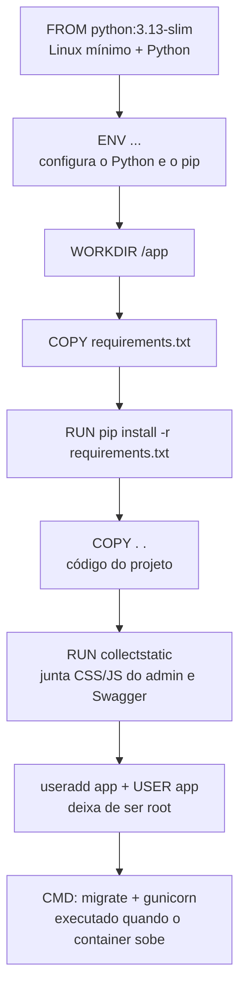

### Linha a linha

```dockerfile
FROM python:3.13-slim
```
Imagem base oficial do Python 3.13 em Debian "slim" (sem pacotes desnecessários, cerca de 45 MB para baixar).

```dockerfile
ENV PYTHONDONTWRITEBYTECODE=1 \
    PYTHONUNBUFFERED=1 \
    PIP_NO_CACHE_DIR=1 \
    PIP_DISABLE_PIP_VERSION_CHECK=1
```
- `PYTHONDONTWRITEBYTECODE=1`: não cria arquivos `.pyc` (inúteis dentro do container).
- `PYTHONUNBUFFERED=1`: o `print`/log aparece na hora em `docker logs`.
- `PIP_NO_CACHE_DIR=1`: o pip não guarda cache, o que deixa a imagem menor.
- `PIP_DISABLE_PIP_VERSION_CHECK=1`: tira o aviso "nova versão do pip".

```dockerfile
WORKDIR /app
COPY requirements.txt .
RUN pip install -r requirements.txt
```
Copia **só** o `requirements.txt` primeiro e instala as dependências. Motivo: o Docker
guarda cada passo em *cache de camadas*. Enquanto o `requirements.txt` não mudar, o
`pip install` (que é o passo demorado) não roda de novo, mesmo que o código mude.

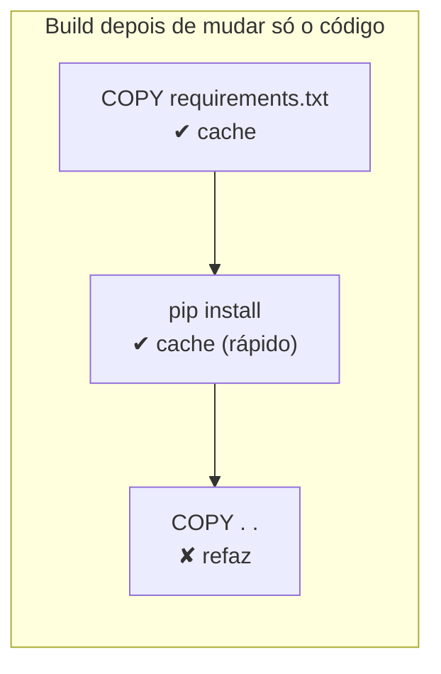

```dockerfile
COPY . .
```
Copia o código. O `.dockerignore` impede que `.env` (segredos), `.venv`, `.git` e
`db.sqlite3` entrem na imagem.

```dockerfile
RUN DJANGO_SECRET_KEY=build-only python manage.py collectstatic --noinput
```
Junta os arquivos estáticos (CSS/JS do Django Admin e do Swagger) em `staticfiles/`.
Com `DEBUG=0` o Django não serve esses arquivos sozinho. Quem serve é o **WhiteNoise**
(middleware configurado no `settings.py`). A `SECRET_KEY` aqui é falsa e só existe
durante o build: o `settings.py` exige uma chave quando `DEBUG=0`.

```dockerfile
RUN useradd --create-home --uid 1000 app && chown -R app /app
USER app
```
Cria um usuário comum e passa a rodar como ele. Se alguém explorar uma falha na
API, não ganha acesso de *root* no container.

```dockerfile
EXPOSE 8000
CMD ["sh", "-c", "python manage.py migrate --noinput && gunicorn config.wsgi:application --bind 0.0.0.0:8000 --workers 3 --access-logfile -"]
```
Quando o container **sobe** (não no build):
1. `migrate` cria/atualiza as tabelas no banco configurado;
2. `gunicorn` inicia o servidor de produção com 3 *workers* (processos) na porta 8000,
   com log de acessos na saída padrão.

> O `runserver` do Django é só para desenvolvimento: ele não aguenta várias
> requisições simultâneas nem é seguro. Em produção usamos o **gunicorn**.

---

## 2. API + banco juntos (`docker-compose.yml`)

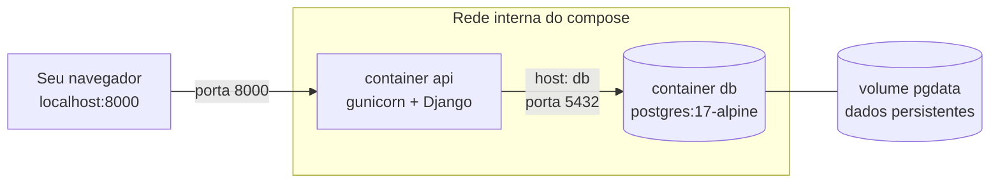

- **`db`**: PostgreSQL 17. Os dados ficam no *volume* `pgdata`, então sobrevivem a
  `docker compose down` e só são apagados com `docker compose down -v`.
- **`healthcheck`**: roda `pg_isready` a cada 5 s. A API só sobe quando o banco
  responde (`depends_on: condition: service_healthy`). Sem isso o `migrate` falharia
  porque o Postgres ainda estaria iniciando.
- **`api`**: construída a partir do `Dockerfile`. Usa `DB_ENGINE=postgres` e
  `POSTGRES_HOST=db`: dentro da rede do compose, o nome do serviço vira o endereço.

### Sequência ao rodar `docker compose up --build`

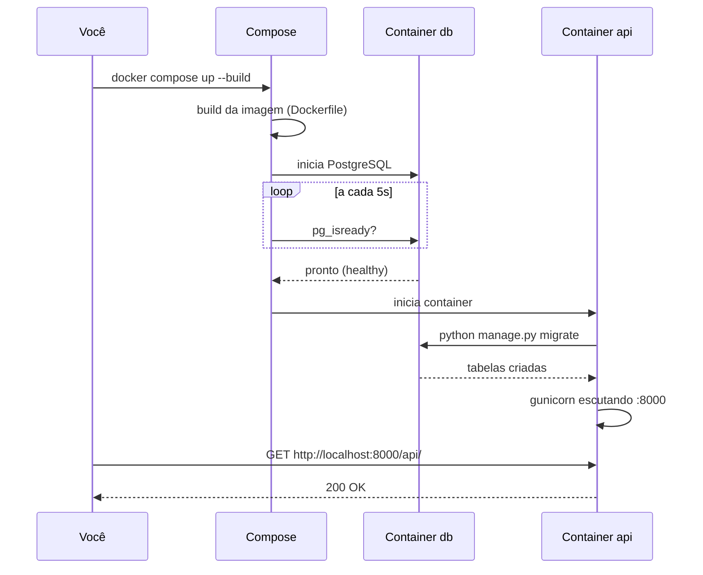

### Comandos úteis

```bash
docker compose up --build            # sobe tudo (Ctrl+C para parar)
docker compose up -d --build         # sobe em segundo plano
docker compose logs -f api           # acompanha os logs da API
docker compose exec api python manage.py createsuperuser   # cria admin
docker compose exec db psql -U easycar -d easycar          # abre o psql no banco
docker compose down                  # para (mantém os dados)
docker compose down -v               # para e APAGA os dados do banco
```

### Validação feita

O build e o compose foram testados localmente:

| Verificação | Resultado |
|---|---|
| Build da imagem | ok (≈ 280 MB) |
| `migrate` no PostgreSQL ao subir | ok |
| `GET /api/` | 200 |
| `GET /static/admin/css/base.css` (WhiteNoise) | 200 |
| `GET /api/carros/` sem login | 401 (protegido) |
| Usuário do processo no container | `app` (não root) |

> ⚠️ A senha do banco (`easycar`) e a `DJANGO_SECRET_KEY` (`troque-em-producao`) que estão
> no `docker-compose.yml` servem **só para uso local**. Em produção, troque as duas e
> defina-as como variáveis/segredos do servidor. Veja
> [banco de produção (variáveis de ambiente)](#variáveis-de-ambiente).

<p align="right">
  <a href="#índice">
    
  </a>
</p>

# Banco de testes (SQLite)

Em desenvolvimento e nos testes automatizados usamos **SQLite**: é um banco num
único arquivo (ou só na memória), já vem com o Python e não precisa instalar nem
configurar servidor nenhum.

Os testes rodam **também no PostgreSQL** (no CI e, se quiser, localmente). O ORM do
Django gera SQL diferente para cada banco, e algumas coisas se comportam de jeito
diferente (por exemplo, `select_for_update` só trava de verdade no PostgreSQL).
Rodar nos dois garante que o que passa aqui funciona em produção.

## Versões

| Item | Versão |
|---|---|
| SQLite | o embutido no Python |
| pytest | 9.2.0 |
| pytest-django | 4.14.0 |
| pytest-cov | 7.1.0 |
| PostgreSQL (CI / teste local opcional) | 17 |

Para ver a versão do SQLite do seu Python:
```bash
python -c "import sqlite3; print(sqlite3.sqlite_version)"
```

## Como o banco de testes funciona

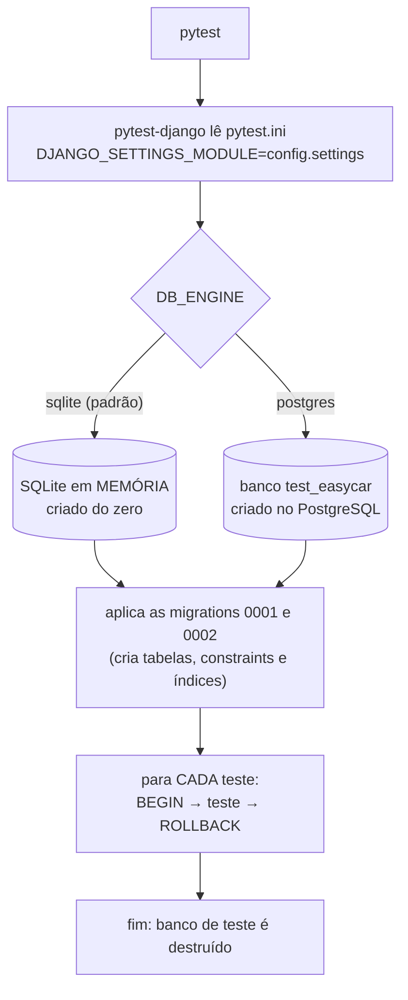

Pontos importantes:

1. **O banco de teste nunca é o seu `db.sqlite3`.** O pytest-django cria um banco
   separado (no SQLite, na memória; no PostgreSQL, um banco `test_<nome>`) e o apaga
   no final. Seus dados de desenvolvimento ficam intactos.
2. **As migrations rodam antes dos testes.** Se uma migration estiver quebrada, os
   testes nem começam. É mais uma garantia.
3. **Cada teste começa com o banco vazio.** Os testes marcados com
   `pytestmark = pytest.mark.django_db` rodam dentro de uma transação que é
   desfeita (*ROLLBACK*) ao final. Nada vaza de um teste para o outro.
4. **Fixtures** (`locadora/tests/conftest.py`) criam os dados de que cada teste
   precisa, sempre do zero:

| Fixture | O que cria |
|---|---|
| `funcionario` | usuário `func` |
| `usuario_cliente` | usuária `maria` (Maria Silva) |
| `perfil` | `PerfilCliente` da Maria (CNH 12345678901) |
| `carro` | Fiat Uno, placa `ABC1D23`, disponível |
| `dados_aluguel` | dicionário com cliente, carro, datas e valor (R$ 350,00) |
| `aluguel` | aluguel **ativo** criado pelo service (o carro fica "alugado") |

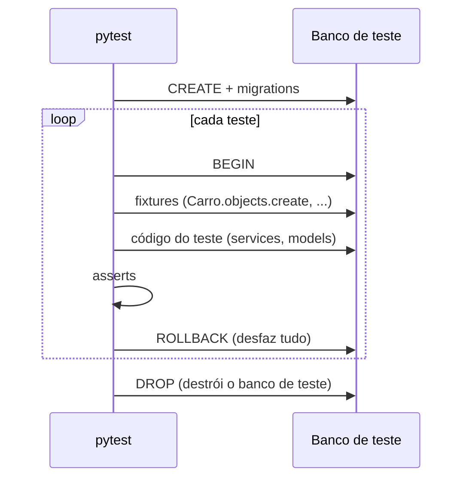

## Como rodar

```bash
# SQLite (padrão, rápido)
pytest

# Sem relatório de cobertura
pytest --no-cov

# Um arquivo / um teste específico
pytest locadora/tests/test_services.py
pytest -k nao_devolve_duas_vezes

# Contra PostgreSQL local (sobe um Postgres temporário na porta 55432)
docker run -d --rm --name pg-teste -e POSTGRES_DB=easycar -e POSTGRES_USER=easycar \
  -e POSTGRES_PASSWORD=easycar -p 55432:5432 postgres:17-alpine
DB_ENGINE=postgres POSTGRES_PASSWORD=easycar POSTGRES_PORT=55432 pytest
docker stop pg-teste
```

> Se aparecer `RuntimeError: Defina DJANGO_SECRET_KEY`, falta o arquivo `.env`
> (copie o `.env.example`) ou exporte `DJANGO_DEBUG=1`.

## Resultado atual

| Banco | Resultado |
|---|---|
| SQLite | **36 testes passando** |
| PostgreSQL 17 | **36 testes passando** |

Cobertura: `services.py` 100%, `models.py` 97%.

## O que cada teste verifica

### `test_models.py`: regras que o **banco** garante (20 testes)

Esses testes criam registros direto pelo ORM, **pulando** as validações da API.
Assim provamos que, mesmo se alguém esquecer uma validação no código, o banco
recusa dados inválidos.

| Teste | O que garante |
|---|---|
| `test_carro_comeca_disponivel` | Carro novo nasce `disponivel`; `str()` mostra "Uno (ABC1D23)" |
| `test_placa_unica` | `UNIQUE`: o banco recusa placa repetida |
| `test_carros_ordenados_por_modelo_e_placa` | Ordenação padrão (`Meta.ordering`) por modelo e placa |
| `test_carro_com_aluguel_nao_pode_ser_excluido` | `on_delete=PROTECT`: carro com histórico não some |
| `test_cnh_unica` | `UNIQUE`: o banco recusa CNH repetida |
| `test_um_perfil_por_usuario` | `OneToOne`: um usuário só tem um perfil |
| `test_excluir_usuario_apaga_perfil_cascade` | `on_delete=CASCADE`: apagar o usuário apaga o perfil |
| `test_perfil_str_usa_nome_completo` | `str()` do perfil mostra o nome completo |
| `test_carros_do_cliente_via_aluguel_sem_repetir` | Relação N:N cliente ↔ carro via `Aluguel`, sem duplicar |
| `test_valor_volta_como_decimal` | Dinheiro volta como `Decimal` e data como `date` nos dois bancos |
| `test_check_fim_nao_pode_ser_antes_do_inicio` | `CHECK`: data de fim ≥ data de início |
| `test_check_valor_do_aluguel_positivo` | `CHECK`: valor do aluguel > 0 |
| `test_um_aluguel_ativo_por_carro` | **UNIQUE parcial**: o banco recusa um 2º aluguel ativo do mesmo carro |
| `test_carro_pode_ter_varios_alugueis_finalizados` | ...mas aceita vários aluguéis **finalizados** do mesmo carro |
| `test_alugueis_mais_recentes_primeiro` | Ordenação padrão: mais recentes primeiro |
| `test_funcionario_com_aluguel_nao_pode_ser_excluido` | `PROTECT`: funcionário com aluguéis registrados não some |
| `test_multa_comeca_pendente` | Multa nasce `pendente`, sem data de pagamento |
| `test_check_valor_da_multa_positivo` | `CHECK`: valor da multa > 0 |
| `test_check_dias_de_atraso_minimo` | `CHECK`: dias de atraso ≥ 1 |
| `test_aluguel_com_multa_nao_pode_ser_excluido` | `PROTECT`: aluguel com multa não some |

### `test_services.py`: regras de negócio e transações (14 testes)

| Teste | O que garante |
|---|---|
| `test_registrar_aluguel_marca_carro_alugado` | Alugar deixa o carro `alugado` e o aluguel `ativo` |
| `test_nao_aluga_carro_indisponivel` (2 casos) | Carro `alugado` ou `manutencao` não pode ser alugado; nada é gravado |
| `test_nao_aluga_o_mesmo_carro_duas_vezes` | O mesmo carro não é alugado duas vezes |
| `test_devolver_finaliza_e_libera_carro` | Devolver finaliza o aluguel com a data de hoje e libera o carro |
| `test_nao_devolve_duas_vezes` | A 2ª devolução dá erro |
| `test_devolver_confere_o_banco_e_nao_o_objeto_em_memoria` | Se outra requisição já finalizou, a devolução lê o valor **atual do banco** e recusa |
| `test_depois_de_devolver_o_carro_pode_ser_alugado_de_novo` | Ciclo completo: alugar → devolver → alugar |
| `test_excluir_aluguel_ativo_libera_carro` | Excluir aluguel ativo devolve o carro para `disponivel` |
| `test_excluir_aluguel_finalizado_nao_mexe_no_carro` | Excluir aluguel antigo não altera o status atual do carro |
| `test_nao_exclui_aluguel_com_multa` | Aluguel com multa não é excluído (mensagem clara, não erro 500) |
| `test_registrar_multa_finaliza_aluguel_e_libera_carro` | Multa criada como `pendente`; aluguel finalizado; carro liberado |
| `test_nao_multa_aluguel_finalizado` | Não dá para multar um aluguel já finalizado |
| `test_erro_no_meio_desfaz_tudo` | `transaction.atomic`: se a multa falha, **nada** muda (aluguel continua ativo) |

### `test_serializers_banco.py`: API × banco (2 testes)

| Teste | O que garante |
|---|---|
| `test_aluguel_serializer_valida_com_a_nova_constraint` | A constraint nova (um aluguel ativo por carro) não atrapalha a validação da API |
| `test_multa_serializer_usa_campos_do_model` | O `MultaSerializer` usa os campos que existem no model (`motivo`) |

## Diferenças SQLite × PostgreSQL

O ORM esconde a maior parte das diferenças, mas não todas:

| Assunto | SQLite | PostgreSQL | Consequência |
|---|---|---|---|
| `select_for_update()` | ignorado (o SQLite trava o arquivo inteiro na escrita) | trava a linha | a proteção contra concorrência só é real no PostgreSQL |
| Decimal | guardado como número genérico | `numeric(10,2)` exato | o ORM converte para `Decimal` nos dois |
| `CHECK` / `UNIQUE` / UNIQUE parcial | aplica | aplica | testados nos dois |
| Erro dentro de transação | a transação continua usável | a transação fica "quebrada" até o ROLLBACK | nos testes, cada tentativa que deve falhar fica dentro de `transaction.atomic()` |
| Comparação de texto | `LIKE` sem diferenciar maiúsculas (ASCII) | `LIKE` diferencia | use `__iexact`/`__icontains` quando quiser ignorar maiúsculas |

## Como escrever um novo teste

```python
import pytest
from locadora import services
from locadora.models import Carro

pytestmark = pytest.mark.django_db   # libera acesso ao banco


def test_algo(aluguel, carro):       # fixtures vêm do conftest.py
    services.devolver_carro(aluguel)
    carro.refresh_from_db()          # relê do banco (o objeto em memória pode estar velho)
    assert carro.status == Carro.Status.DISPONIVEL
```

Para testar um erro do banco, use `transaction.atomic()` em volta. Sem ele, a
transação do teste fica "quebrada" no PostgreSQL:

```python
from django.db import IntegrityError, transaction

with pytest.raises(IntegrityError), transaction.atomic():
    Carro.objects.create(modelo='Uno', placa='ABC1D23', ano=2020)  # placa repetida
```

<p align="right">
  <a href="#índice">
    
  </a>
</p>

# Banco de produção (PostgreSQL)

Em produção usamos **PostgreSQL 17**: aguenta muitos acessos simultâneos, trava
linhas individuais (`SELECT ... FOR UPDATE`), tem tipos de dados exatos (`numeric`,
`date`) e ferramentas de backup. O acesso é feito pelo **ORM do Django**, o mesmo
código usado com SQLite nos testes.

## Como a aplicação escolhe o banco

Em `config/settings.py`:

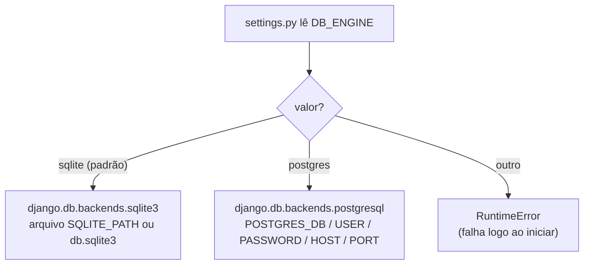

No PostgreSQL também estão ligados:
- `CONN_MAX_AGE = 60`: reaproveita a conexão por até 60 s, em vez de abrir uma nova a cada requisição;
- `CONN_HEALTH_CHECKS = True`: antes de reaproveitar, confere se a conexão ainda está viva.

## Variáveis de ambiente

| Variável | Exemplo | Obrigatória em produção | Descrição |
|---|---|---|---|
| `DJANGO_SECRET_KEY` | (string longa e aleatória) | **sim** | Chave secreta do Django, usada para assinar sessões e tokens. Sem ela e com `DEBUG=0`, a aplicação não sobe |
| `DJANGO_DEBUG` | `0` | sim | `1` só em desenvolvimento. O padrão é `0` (seguro) |
| `DJANGO_ALLOWED_HOSTS` | `api.easycar.com.br` | sim | Domínios aceitos, separados por vírgula |
| `DB_ENGINE` | `postgres` | sim | `sqlite` ou `postgres` |
| `POSTGRES_DB` | `easycar` | sim | Nome do banco |
| `POSTGRES_USER` | `easycar` | sim | Usuário do banco |
| `POSTGRES_PASSWORD` | (segredo) | **sim** | Senha do banco |
| `POSTGRES_HOST` | `db` / IP / host gerenciado | sim | Endereço do servidor |
| `POSTGRES_PORT` | `5432` | não | Porta (padrão 5432) |
| `SQLITE_PATH` | `db.sqlite3` | não | Só quando `DB_ENGINE=sqlite` |

Para gerar uma `DJANGO_SECRET_KEY`:
```bash
python -c "from django.core.management.utils import get_random_secret_key as k; print(k())"
```

> Nunca coloque senhas reais no Git. O `.env` está no `.gitignore`. No servidor,
> use as variáveis/segredos da hospedagem.

## Como o ORM conversa com o banco

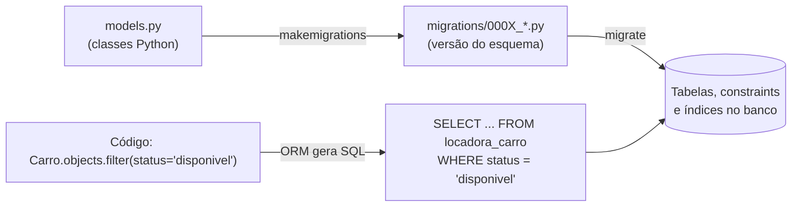

- **`models.py`** descreve as tabelas em Python.
- **`makemigrations`** compara os models com as migrations e gera um arquivo novo
  com as diferenças. Esse arquivo **vai para o Git**.
- **`migrate`** aplica no banco as migrations que ainda não foram aplicadas. No
  Docker isso roda sozinho ao subir o container.
- O Django guarda o que já foi aplicado na tabela `django_migrations`.

Migrations do projeto:

| Migration | O que faz |
|---|---|
| `0001_initial` | Cria as tabelas `locadora_carro`, `locadora_perfilcliente`, `locadora_aluguel`, `locadora_multa` |
| `0002_constraints_e_indices` | Índices em `status` (carro e aluguel), "um aluguel ativo por carro", `CHECK` de valor e dias de atraso da multa |

Para ver o SQL que uma migration gera no PostgreSQL (precisa do banco no ar):
```bash
DB_ENGINE=postgres python manage.py sqlmigrate locadora 0002
```

## Modelo de dados

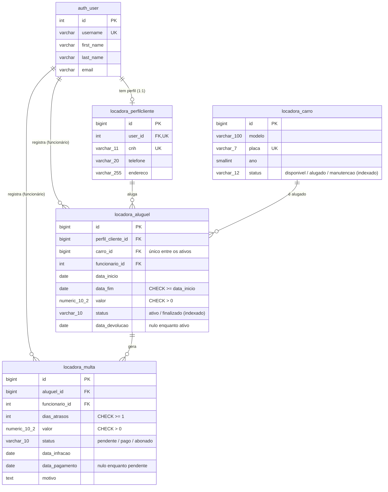

Relações:
- **1:1**: `auth_user` ↔ `locadora_perfilcliente` (um usuário cliente tem um perfil).
- **1:N**: funcionário → aluguéis; funcionário → multas; aluguel → multas.
- **N:N**: cliente ↔ carro, usando `locadora_aluguel` como tabela intermediária
  (`PerfilCliente.carros = ManyToManyField(through='Aluguel')`).

### Regras garantidas

| Regra | Onde | Quem garante |
|---|---|---|
| Placa única | `Carro.placa unique=True` | banco (`UNIQUE`) |
| CNH única | `PerfilCliente.cnh unique=True` | banco (`UNIQUE`) |
| Um perfil por usuário | `OneToOneField` | banco (`UNIQUE`) |
| Fim do aluguel ≥ início | `CheckConstraint aluguel_fim_depois_do_inicio` | banco (`CHECK`) |
| Valor do aluguel > 0 | `CheckConstraint aluguel_valor_positivo` | banco (`CHECK`) |
| **Um aluguel ativo por carro** | `UniqueConstraint aluguel_um_ativo_por_carro` (condição `status='ativo'`) | banco (índice único parcial) |
| Valor da multa > 0 | `CheckConstraint multa_valor_positivo` | banco (`CHECK`) |
| Dias de atraso ≥ 1 | `CheckConstraint multa_dias_atraso_minimo` | banco (`CHECK`) |
| Não apagar carro/cliente/funcionário/aluguel com histórico | `on_delete=PROTECT` | Django (ORM) |
| Apagar usuário apaga o perfil | `on_delete=CASCADE` | Django (ORM) |
| Status do carro acompanha o aluguel | `services.py` | código, em transação |

> As regras de `CHECK`/`UNIQUE` valem **mesmo se alguém pular a API** (admin,
> shell, script). O `PROTECT`/`CASCADE` é aplicado pelo ORM, então funciona sempre
> que o acesso passa pelo Django.

## Ciclo de vida dos status

**Carro**

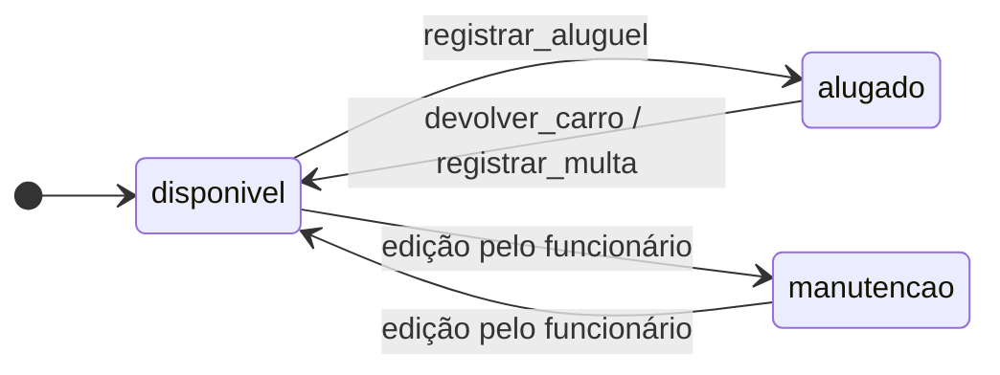

**Aluguel**

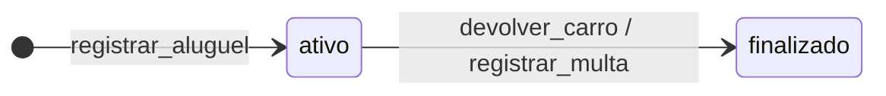

**Multa**

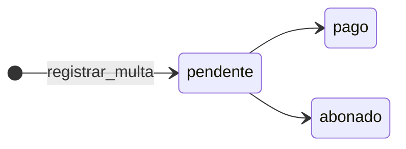

## Transações e concorrência

Toda operação que mexe em mais de uma tabela está em `services.py`, dentro de
`@transaction.atomic`: ou grava **tudo**, ou **nada**. Exemplo:
`registrar_multa` cria a multa, finaliza o aluguel e libera o carro. Se qualquer
passo falhar, os outros são desfeitos.

As linhas envolvidas são travadas com `select_for_update()`. Quando dois
funcionários tentam alugar o mesmo carro no mesmo instante:

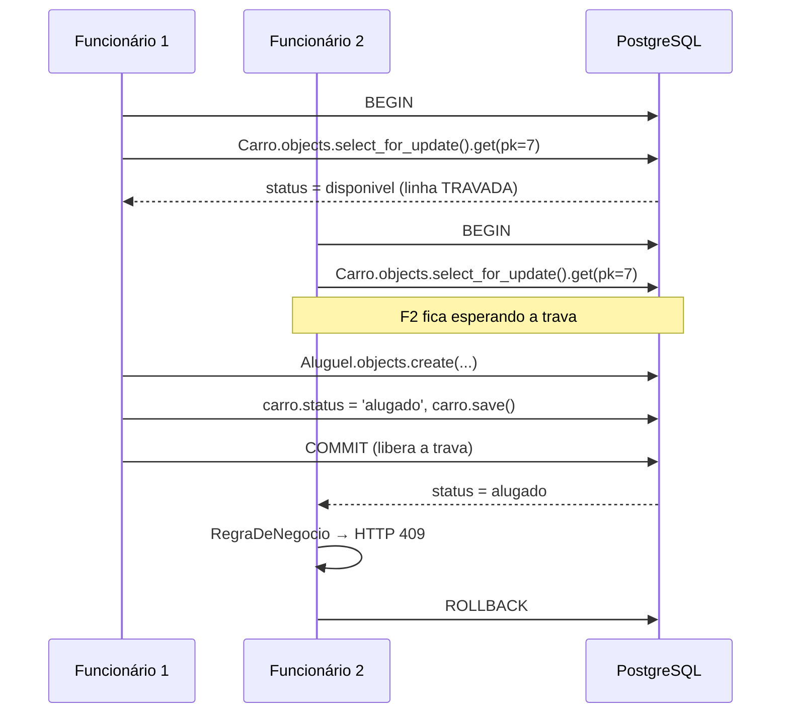

Se mesmo assim algo escapar, a constraint `aluguel_um_ativo_por_carro` recusa o
segundo aluguel ativo no próprio banco.

O código correspondente (`locadora/services.py`):

```python
@transaction.atomic
def registrar_aluguel(dados: dict[str, Any], funcionario: User) -> Aluguel:
    carro = Carro.objects.select_for_update().get(pk=dados['carro'].pk)
    if carro.status != Carro.Status.DISPONIVEL:
        raise RegraDeNegocio(f'O carro {carro.placa} não está disponível (...).')
    aluguel = Aluguel.objects.create(funcionario=funcionario, **{**dados, 'carro': carro})
    carro.status = Carro.Status.ALUGADO
    carro.save(update_fields=['status'])
    return aluguel
```

Na devolução e na multa, o service relê o status **do banco** (travando a linha)
em vez de confiar no objeto em memória. Assim, se outra requisição acabou de
finalizar o aluguel, a segunda é recusada.

## Arquitetura de produção sugerida

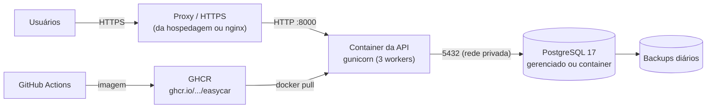

- O PostgreSQL **não** deve ficar exposto na internet: só a API acessa.
- O HTTPS fica no proxy/hospedagem. Depois de ativado, ligue no `settings.py`:
  `SECURE_PROXY_SSL_HEADER`, `SESSION_COOKIE_SECURE`, `CSRF_COOKIE_SECURE` e
  `SECURE_SSL_REDIRECT` (o `manage.py check --deploy` lista o que falta).

## Backup e restauração

```bash
# Backup (formato compactado)
docker compose exec db pg_dump -U easycar -d easycar -Fc > backup_$(date +%F).dump

# Restaurar
docker compose exec -T db pg_restore -U easycar -d easycar --clean < backup_2026-11-09.dump
```

## Checklist de deploy

- [ ] `DJANGO_DEBUG=0`
- [ ] `DJANGO_SECRET_KEY` nova e secreta
- [ ] `DJANGO_ALLOWED_HOSTS` com o domínio real
- [ ] Senha forte em `POSTGRES_PASSWORD`
- [ ] Banco acessível só pela API (rede privada)
- [ ] HTTPS ativo + configurações `SECURE_*`
- [ ] Backup automático configurado
- [ ] `python manage.py check --deploy` sem avisos
- [ ] `python manage.py migrate` aplicado (o container já faz ao subir)
- [ ] `python manage.py createsuperuser` para o primeiro admin
- [ ] Grupos `Funcionários` e `Clientes` criados no admin

<p align="right">
  <a href="#índice">
    
  </a>
</p>

# CI/CD (GitHub Actions)

Arquivo: `.github/workflows/ci.yml`. Roda automaticamente:
- em todo **pull request**;
- em todo **push na `main`**.

## Pipeline

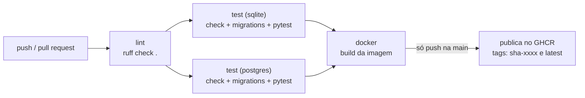

Se uma etapa falha, as seguintes não rodam e o PR aparece com ❌.

## Etapas

### 1. `lint`
Roda `ruff check .`, que procura erros como import não usado, variável indefinida e
sintaxe inválida. As regras estão em `pyproject.toml`.

### 2. `test` (matriz: `sqlite` e `postgres`)
Dois jobs em paralelo, um para cada banco. O PostgreSQL 17 sobe como *service
container* do GitHub. Cada job:
1. instala `requirements-dev.txt` (com cache do pip);
2. `python manage.py check --deploy --fail-level ERROR`: valida a configuração;
3. `python manage.py makemigrations --check --dry-run`: falha se alguém mudou um
   model e esqueceu de gerar a migration;
4. `pytest`: roda os testes com relatório de cobertura.

`fail-fast: false`: se o SQLite falhar, o PostgreSQL continua, para vermos os dois resultados.

### 3. `docker`
Constrói a imagem com o `Dockerfile` (cache do GitHub Actions para ficar rápido).
- Em **pull request**: só constrói, para provar que o build funciona.
- Em **push na `main`**: publica em `ghcr.io/<dono-do-repo>/easycar` com as tags
  `sha-<commit>` e `latest`. Usa o `GITHUB_TOKEN` automático, então não é preciso
  configurar segredo.

## Plano de testes por camada

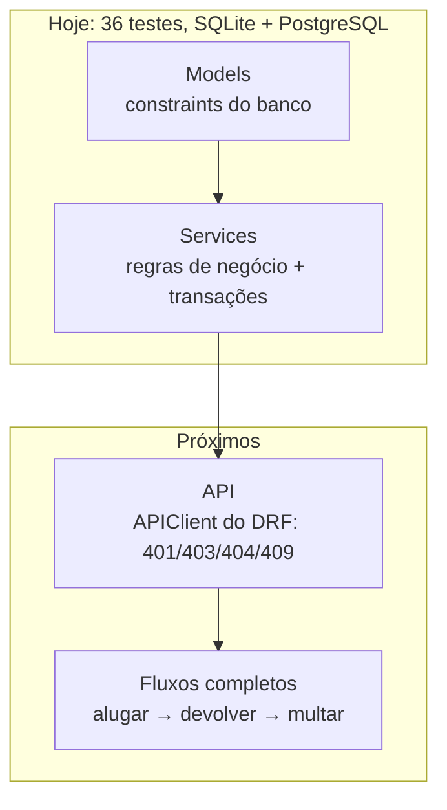

| Camada | O que testar | Situação |
|---|---|---|
| Models | constraints (UNIQUE, CHECK, um aluguel ativo por carro), PROTECT/CASCADE, tipos, ordenação | ✅ feito (20 testes) |
| Services | carro indisponível, devolução dupla, multa, rollback da transação | ✅ feito (14 testes) |
| Serializers × banco | a constraint nova não atrapalha a validação da API | ✅ feito (2 testes) |
| API | sem login 401, cliente sem permissão 403/404, conflito 409 | pendente |
| Fluxos | alugar → devolver; alugar → multar; excluir carro com aluguel | pendente |

Quando as outras camadas tiverem testes, adicione um mínimo de cobertura no
`pytest.ini` (ex.: `--cov-fail-under=70`) para o CI barrar PR que diminua a cobertura.

## Rodar as mesmas checagens localmente

```bash
ruff check .
python manage.py check
python manage.py makemigrations --check --dry-run
pytest
docker build -t easycar .
```

## Recomendado no GitHub

Em *Settings → Branches → Branch protection rules* para `main`:
- exigir PR para fazer merge;
- exigir que os jobs `lint`, `test (sqlite)`, `test (postgres)` e `docker` passem.

<p align="right">
  <a href="#índice">
    
  </a>
</p>

# Padrões de código

## 1. Arquitetura em camadas

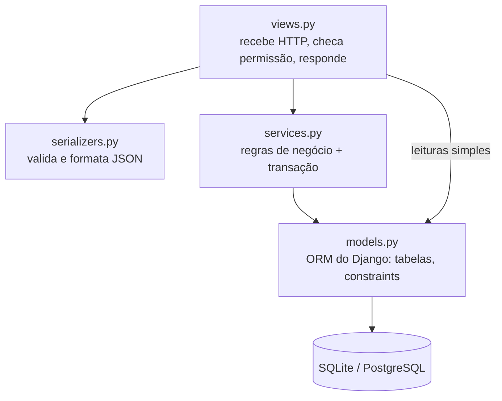

| Camada | Responsabilidade | Não deve |
|---|---|---|
| `models.py` | estrutura das tabelas, relações, `constraints`, `indexes`, `ordering`, `__str__` | conter regra que envolva várias tabelas |
| `serializers.py` | validar formato da entrada (placa, CNH, datas) e montar o JSON | mudar status ou gravar em outras tabelas |
| `services.py` | regras que mexem em mais de uma tabela, sempre em `transaction.atomic` | conhecer HTTP (status code, `request`) |
| `views.py` | permissões, escolher o queryset, chamar o service, converter erro em HTTP | ter regra de negócio |

Regra prática: se a operação altera **mais de uma tabela** ou muda um **status**,
ela vai para `services.py`.

## 2. Boas práticas com o ORM

### Regras de dados no model (o banco garante)

```python
class Meta:
    constraints = [
        models.CheckConstraint(condition=models.Q(valor__gt=0), name='aluguel_valor_positivo'),
        models.UniqueConstraint(fields=['carro'], condition=models.Q(status='ativo'),
                                name='aluguel_um_ativo_por_carro'),
    ]
    indexes = [models.Index(fields=['status'], name='aluguel_status_idx')]
```

- Valide **no serializer** (para mensagem amigável) **e** no **model/banco** (para
  garantia). O serializer pode ser pulado (admin, shell, script); o banco, não.
- Nomeie constraints e índices: `<tabela>_<regra>`.

### Sempre pelo ORM, nunca SQL na mão

```python
# ✅ CERTO
Carro.objects.filter(placa=placa)

# ❌ ERRADO: SQL injection se 'placa' vier do usuário
Carro.objects.raw(f"SELECT * FROM locadora_carro WHERE placa = '{placa}'")
```

Se um dia precisar de SQL na mão, use parâmetros:
`Carro.objects.raw('... WHERE placa = %s', [placa])`.

### Evitar N+1 consultas

```python
# ❌ 1 consulta para os aluguéis + 1 por aluguel para o carro + 1 para o cliente...
for a in Aluguel.objects.all():
    print(a.carro.placa, a.perfil_cliente.user.username)

# ✅ tudo em 1 consulta com JOIN
Aluguel.objects.select_related('carro', 'perfil_cliente__user', 'funcionario')
```

- `select_related` para ForeignKey/OneToOne (JOIN).
- `prefetch_related` para "muitos" (ManyToMany, relação reversa).
- O projeto já faz isso em `views.alugueis_completos()`.

### Transações e travas

```python
@transaction.atomic                                     # tudo ou nada
def registrar_aluguel(dados: dict[str, Any], funcionario: User) -> Aluguel:
    carro = Carro.objects.select_for_update().get(pk=dados['carro'].pk)   # trava a linha
    ...
```

- `@transaction.atomic` em todo service que grava em mais de um lugar.
- `select_for_update()` quando ler um valor para decidir e depois gravar
  ("está disponível? então aluga"). Só trava no PostgreSQL.
- Decida com o valor **do banco**, não com o objeto antigo em memória. Use
  `refresh_from_db()` ou releia com `select_for_update()`.

### Gravar só o que mudou

```python
carro.status = Carro.Status.ALUGADO
carro.save(update_fields=['status'])     # UPDATE só da coluna status
```

### Status com `TextChoices`

```python
class Status(models.TextChoices):
    DISPONIVEL = 'disponivel', 'Disponível'
...
if carro.status != Carro.Status.DISPONIVEL:   # ✅ nunca compare com a string solta 'disponivel'
```

### Migrations

1. Alterou um model → `python manage.py makemigrations -n nome_descritivo`.
2. Confira o arquivo gerado e faça commit **junto** com a alteração do model.
3. Nunca edite uma migration que já foi para a `main`: crie uma nova.
4. O CI falha se houver model alterado sem migration (`makemigrations --check`).

## 3. Type hints

Todo código novo tem **type hints** em parâmetros e retorno:

```python
def registrar_multa(
    aluguel: Aluguel,
    funcionario: User,
    *,
    valor: Decimal,
    dias_atrasos: int,
    motivo: str,
    data_infracao: date,
) -> Multa: ...
```

| Situação | Como tipar |
|---|---|
| Instância de model | a própria classe: `Carro`, `Aluguel` |
| Usuário | `User` (`django.contrib.auth.models`) |
| Pode não existir | `X \| None` (não `Optional[X]`) |
| Listas/dicts | `list[Carro]`, `dict[str, Any]` (minúsculo, sem `typing.List`) |
| Dinheiro | `Decimal` (nunca `float`) |
| Datas | `datetime.date` |
| Muitos parâmetros do mesmo tipo | `*` para obrigar nome: `registrar_multa(..., valor=..., motivo=...)` |
| Topo do arquivo | `from __future__ import annotations` |

Verificação opcional de tipos:
```bash
pip install mypy django-stubs
mypy locadora/services.py
```

## 4. Nomes

| O quê | Padrão | Exemplo |
|---|---|---|
| Idioma | português, sem acento no código | `aluguel`, `data_devolucao` |
| Funções/variáveis | `snake_case`, verbo para ação | `registrar_aluguel`, `devolver_carro` |
| Classes | `PascalCase` | `PerfilCliente`, `RegraDeNegocio` |
| Constantes | `MAIUSCULAS` | `GRUPO_FUNCIONARIOS` |
| Funções internas | `_` no início | `_finalizar`, `_travar_aluguel_ativo` |
| Booleanos | `eh_*`, `tem_*`, `pode_*` | `eh_funcionario` |
| Constraints/índices | `<tabela>_<regra>` | `aluguel_valor_positivo`, `carro_status_idx` |

## 5. Erros

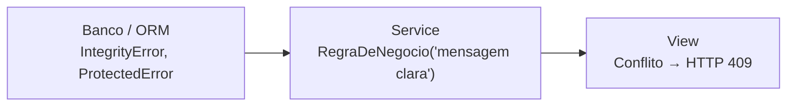

- O service transforma erro técnico em `RegraDeNegocio` com uma mensagem para o
  usuário (ex.: `ProtectedError` → "Este aluguel tem multas vinculadas...").
- A view converte `RegraDeNegocio` em resposta HTTP (`409 Conflict`).
- Use `raise ... from erro` para não perder a causa original.

## 6. Testes

- Todo service novo ganha teste em `locadora/tests/test_services.py`.
- Toda constraint nova ganha teste em `locadora/tests/test_models.py`.
- Teste o caminho feliz **e** os erros (carro indisponível, devolução dupla...).
- Detalhes: [Banco de testes](#banco-de-testes-sqlite).

## 7. Estilo e ferramentas

- **ruff** para lint (`ruff check .`). Configuração em `pyproject.toml`: linhas de
  até 120 caracteres, aspas simples.
- Docstring curta em toda função de service explicando **o que** faz e as regras.
- Um commit por assunto, mensagem no imperativo em português
  (ex.: `Adiciona constraint de multa`).
- Branches: `feature/<assunto>`, `fix/<assunto>`, `docs/<assunto>`. Nada direto na `main`.

## 8. Checklist de PR

- [ ] `ruff check .` sem erros
- [ ] `pytest` passando (o CI roda em SQLite e PostgreSQL)
- [ ] Mudou model? Gerou migration e fez commit dela
- [ ] Regra que mexe em mais de uma tabela está em `services.py` com `transaction.atomic`
- [ ] Consultas com `select_related`/`prefetch_related` quando usam relações
- [ ] Type hints em funções novas
- [ ] Testes para o código novo
- [ ] Documentação em `docs/` atualizada se mudou comportamento

<p align="right">
  <a href="#índice">
    
  </a>
</p>

# Alterações da branch `feature/banco-de-dados`

Objetivo: preparar a camada de banco de dados com **SQLite para desenvolvimento/testes**
e **PostgreSQL para produção**, usando o **ORM do Django**, mais Docker e CI.

## Resumo

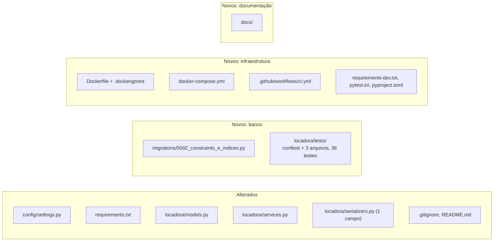

## Decisão: ORM do Django

O projeto usa o **ORM do Django** para acessar o banco. Uma versão anterior desta
branch tinha uma camada de SQL puro (`locadora/db.py` e `locadora/repositories/`),
que foi **removida** depois dessa decisão. Motivos:

- o projeto já usa models, `ModelSerializer`, `ModelViewSet` e o admin, que dependem do ORM;
- o ORM gera o SQL certo para SQLite e PostgreSQL, sem precisar tratar as diferenças na mão;
- uma camada de SQL puro ao lado do ORM seria código duplicado para manter.

## Arquivos alterados

### `config/settings.py`
| Antes | Depois | Por quê |
|---|---|---|
| Só SQLite | `DB_ENGINE=sqlite` ou `postgres` por variável de ambiente | Um banco para testes, outro para produção, sem mudar código |
| `DEBUG` padrão `1` | padrão `0` | Seguro por padrão: esquecer a variável em produção não liga o modo debug |
| `SECRET_KEY` com valor padrão sempre | só tem padrão com `DEBUG=1`; senão dá erro | Impede subir produção com chave conhecida |
| `ALLOWED_HOSTS` fixo | `DJANGO_ALLOWED_HOSTS` (lista por vírgula) | Permite configurar o domínio real |
| — | `WhiteNoiseMiddleware` + `STATIC_ROOT` | Admin e Swagger com CSS em produção |
| — | `CONN_MAX_AGE`, `CONN_HEALTH_CHECKS` (Postgres) | Reaproveita conexões com segurança |

### `locadora/models.py` + migration `0002_constraints_e_indices`
| Adicionado | Onde | Por quê |
|---|---|---|
| `UniqueConstraint aluguel_um_ativo_por_carro` | `Aluguel` | O banco impede dois aluguéis ativos do mesmo carro |
| `CheckConstraint multa_valor_positivo` | `Multa` | Multa com valor zero/negativo é recusada pelo banco |
| `CheckConstraint multa_dias_atraso_minimo` | `Multa` | Dias de atraso precisa ser ≥ 1 |
| `Index carro_status_idx` | `Carro` | Acelera `/api/carros/?status=disponivel` |
| `Index aluguel_status_idx` | `Aluguel` | Acelera filtros de aluguéis ativos |

Os campos e tabelas **não mudaram**: a migration só adiciona regras e índices.

### `locadora/services.py`
| Função | Mudança |
|---|---|
| todas | type hints em parâmetros e retorno |
| `registrar_aluguel` | sem mudança de comportamento |
| `devolver_carro` | trava o aluguel e confere o status **no banco**, impedindo duas devoluções simultâneas |
| `excluir_aluguel` | aluguel com multa gera `RegraDeNegocio` com mensagem clara, em vez de `ProtectedError` |
| `registrar_multa` | **corrigido**: usava o campo inexistente `descricao` e não preenchia `dias_atrasos` (obrigatório), então quebrava sempre. Agora recebe `valor`, `dias_atrasos`, `motivo` e `data_infracao` por nome. Nenhuma view a chamava ainda |

### `locadora/serializers.py`
Só uma correção: `'descricao'` → `'motivo'` no `MultaSerializer`. O campo não
existia no model e quebrava o CI e o Swagger.

### `requirements.txt`
Versões fixadas (`==`) em releases estáveis e adicionados `psycopg[binary]`,
`gunicorn` e `whitenoise`. Tabela completa em [README (versões utilizadas)](#versões-utilizadas).

### Outros
- `.gitignore`: `staticfiles/`, `.pytest_cache/`, `.coverage`, `htmlcov/`.
- `README.md`: descrição do projeto, como rodar, link para `docs/`.

## Arquivos novos

| Arquivo | O que é |
|---|---|
| `locadora/migrations/0002_constraints_e_indices.py` | Constraints e índices novos |
| `locadora/tests/conftest.py` | Fixtures: funcionário, cliente, perfil, carro, aluguel |
| `locadora/tests/test_models.py` | 20 testes das regras do banco |
| `locadora/tests/test_services.py` | 14 testes das regras de negócio |
| `locadora/tests/test_serializers_banco.py` | 2 testes de API × banco |
| `Dockerfile`, `.dockerignore` | Imagem de produção ([Docker](#docker)) |
| `docker-compose.yml` | API + PostgreSQL local ([Docker](#docker)) |
| `.github/workflows/ci.yml` | Pipeline ([CI/CD](#cicd-github-actions)) |
| `requirements-dev.txt` | pytest, pytest-django, pytest-cov, ruff |
| `pytest.ini` | Configuração do pytest + cobertura |
| `pyproject.toml` | Configuração do ruff |
| `docs/` | Esta documentação |

## O que NÃO foi alterado

- `views.py`, `admin.py`, `permissions.py`, `urls.py`: iguais ao original.
- Migration `0001_initial`: intacta.
- `.env.example`: mantido. As novas variáveis estão documentadas em
  [banco de produção (variáveis de ambiente)](#variáveis-de-ambiente).

## Validação

| Verificação | Resultado |
|---|---|
| `ruff check .` | sem erros |
| `pytest` no SQLite | 36 passando |
| `pytest` no PostgreSQL 17 | 36 passando |
| `manage.py makemigrations --check` | nenhuma migration pendente |
| `manage.py check --deploy` | sem erros, só avisos de HTTPS (ver pendências) |
| Geração do Swagger (`manage.py spectacular`) | ok |
| `docker compose up --build` | API 200, estáticos 200, rota protegida 401 |

## Impacto para o time

- Depois de puxar a branch: `pip install -r requirements-dev.txt` e `python manage.py migrate`.
- Quem roda localmente precisa do `.env` (copiado do `.env.example`, que já tem
  `DJANGO_DEBUG=1`). Sem ele, o Django pede a `DJANGO_SECRET_KEY`.
- Se o `db.sqlite3` local tiver **dois aluguéis ativos do mesmo carro** ou **multa com
  valor ≤ 0 / dias de atraso 0**, a migration `0002` falha. Corrija esses registros
  ou apague o `db.sqlite3` (é só de desenvolvimento) e rode `migrate` de novo.

<p align="right">
  <a href="#índice">
    
  </a>
</p>

# Pendências

## Banco de dados (escopo desta branch)

| # | Pendência | Prioridade |
|---|---|---|
| 1 | Criar uma rota na API para registrar multa usando `services.registrar_multa` (hoje o `MultaViewSet` grava direto, sem finalizar o aluguel nem liberar o carro) | alta |
| 2 | Comando de *seed* (`python manage.py popular_banco`) com carros/clientes de exemplo para a apresentação. A pasta `locadora/management/commands/` já existe e está vazia | média |
| 3 | Adicionar as novas variáveis (`DB_ENGINE`, `POSTGRES_*`, `DJANGO_ALLOWED_HOSTS`) no `.env.example` | baixa |
| 4 | Configurar backup automático no servidor de produção | quando houver servidor |

## Encontrado em outras partes do código (avisar o time)

| # | Arquivo | Problema | Situação |
|---|---|---|---|
| 1 | `serializers.py` (`MultaSerializer`) | Usava `descricao` em vez de `motivo` | ✅ corrigido nesta branch |
| 2 | `services.py` (`registrar_multa`) | Usava `descricao` e não preenchia `dias_atrasos` | ✅ corrigido nesta branch |
| 3 | `services.py` (`devolver_carro`) | Não travava o aluguel (devolução dupla simultânea) | ✅ corrigido nesta branch |
| 4 | `serializers.py` (`CarroSerializer`) | Faltava o campo `marca` (obrigatório no banco). Criar carro pela API dava erro 500 | ✅ resolvido: `marca` foi removida do modelo (migração `0002_remove_carro_marca`, marca + modelo juntos em `modelo`) |
| 5 | `views.py` (`MultaViewSet`) | O `funcionario` vem do corpo da requisição; deveria ser o usuário logado | pendente |
| 6 | `views.py` (`AluguelViewSet.perform_destroy`) | Não trata `RegraDeNegocio` do `excluir_aluguel`. Excluir aluguel com multa dá 500; deveria dar 409 com `raise Conflito(str(erro))`, como nas outras ações | pendente |
| 7 | `config/settings.py` | Depois do HTTPS: `SECURE_PROXY_SSL_HEADER`, `SESSION_COOKIE_SECURE`, `CSRF_COOKIE_SECURE`, `SECURE_SSL_REDIRECT`, `SECURE_HSTS_SECONDS` | quando houver HTTPS |
| 8 | Testes da API | Nenhuma view tinha teste (usar `APIClient` do DRF: 401/403/404/409) | ✅ resolvido: `test_alugueis.py`, `test_permissoes.py`, `test_relacionamentos.py` |

<p align="right">
  <a href="#índice">
    
  </a>
</p>

# Referências bibliográficas

Fontes usadas para construir o EasyCar (API, banco de dados, testes, Docker, CI/CD,
dashboard e deploy). Formato baseado na ABNT NBR 6023 para documentos online.

## Orientação e Créditos

Projeto Integrador desenvolvido por Luiz, Barbiana e Yandra.
Camada de banco de dados, Docker, CI/CD e documentação feitas com orientação e ajuda do **Prof. Henry**, Tech Lead da **Brassol Distribuidora**.

## Linguagem e framework

- PYTHON SOFTWARE FOUNDATION. **Python 3.13 Documentation**. Disponível em: <https://docs.python.org/3.13/>. Acesso em: 12 nov. 2026.
- PYTHON SOFTWARE FOUNDATION. **typing — Support for type hints**. Disponível em: <https://docs.python.org/3/library/typing.html>. Acesso em: 12 nov. 2026.
- DJANGO SOFTWARE FOUNDATION. **Django 5.2 Documentation**. Disponível em: <https://docs.djangoproject.com/en/5.2/>. Acesso em: 12 nov. 2026.
- DJANGO SOFTWARE FOUNDATION. **Models and databases**. Disponível em: <https://docs.djangoproject.com/en/5.2/topics/db/>. Acesso em: 12 nov. 2026.
- DJANGO SOFTWARE FOUNDATION. **Migrations**. Disponível em: <https://docs.djangoproject.com/en/5.2/topics/migrations/>. Acesso em: 12 nov. 2026.
- DJANGO SOFTWARE FOUNDATION. **Database transactions**. Disponível em: <https://docs.djangoproject.com/en/5.2/topics/db/transactions/>. Acesso em: 12 nov. 2026.
- DJANGO SOFTWARE FOUNDATION. **Model Meta options: constraints and indexes**. Disponível em: <https://docs.djangoproject.com/en/5.2/ref/models/options/>. Acesso em: 12 nov. 2026.
- DJANGO SOFTWARE FOUNDATION. **User authentication in Django**. Disponível em: <https://docs.djangoproject.com/en/5.2/topics/auth/>. Acesso em: 12 nov. 2026.
- DJANGO SOFTWARE FOUNDATION. **Testing in Django**. Disponível em: <https://docs.djangoproject.com/en/5.2/topics/testing/>. Acesso em: 12 nov. 2026.
- DJANGO SOFTWARE FOUNDATION. **Deployment checklist**. Disponível em: <https://docs.djangoproject.com/en/5.2/howto/deployment/checklist/>. Acesso em: 12 nov. 2026.
- DJANGO SOFTWARE FOUNDATION. **Download / Supported versions (LTS)**. Disponível em: <https://www.djangoproject.com/download/>. Acesso em: 12 nov. 2026.

## API REST e documentação da API

- ENCODE. **Django REST framework**. Disponível em: <https://www.django-rest-framework.org/>. Acesso em: 12 nov. 2026.
- ENCODE. **Django REST framework: Authentication, Permissions, Serializers, ViewSets, Testing**. Disponível em: <https://www.django-rest-framework.org/api-guide/>. Acesso em: 12 nov. 2026.
- DRF-SPECTACULAR. **drf-spectacular documentation**. Disponível em: <https://drf-spectacular.readthedocs.io/>. Acesso em: 12 nov. 2026.
- OPENAPI INITIATIVE. **OpenAPI Specification v3.0.3**. Disponível em: <https://spec.openapis.org/oas/v3.0.3>. Acesso em: 12 nov. 2026.
- FIELDING, Roy Thomas. **Architectural Styles and the Design of Network-based Software Architectures**. 2000. Tese (Doutorado) – University of California, Irvine. Disponível em: <https://ics.uci.edu/~fielding/pubs/dissertation/top.htm>. Acesso em: 12 nov. 2026.
- FIELDING, R.; NOTTINGHAM, M.; RESCHKE, J. **RFC 9110: HTTP Semantics**. IETF, 2022. Disponível em: <https://www.rfc-editor.org/rfc/rfc9110>. Acesso em: 12 nov. 2026.

## Banco de dados

- THE POSTGRESQL GLOBAL DEVELOPMENT GROUP. **PostgreSQL 17 Documentation**. Disponível em: <https://www.postgresql.org/docs/17/>. Acesso em: 12 nov. 2026.
- THE POSTGRESQL GLOBAL DEVELOPMENT GROUP. **Constraints; Indexes; Partial Indexes; Transaction Isolation; pg_dump**. Disponível em: <https://www.postgresql.org/docs/17/ddl-constraints.html>. Acesso em: 12 nov. 2026.
- SQLITE. **SQLite Documentation**. Disponível em: <https://www.sqlite.org/docs.html>. Acesso em: 12 nov. 2026.
- PSYCOPG. **Psycopg 3 documentation**. Disponível em: <https://www.psycopg.org/psycopg3/docs/>. Acesso em: 12 nov. 2026.
- KIMBALL, J. **dj-database-url**. Disponível em: <https://github.com/jazzband/dj-database-url>. Acesso em: 12 nov. 2026.
- ELMASRI, Ramez; NAVATHE, Shamkant B. **Sistemas de banco de dados**. 7. ed. São Paulo: Pearson, 2018.
- SILBERSCHATZ, Abraham; KORTH, Henry F.; SUDARSHAN, S. **Sistema de banco de dados**. 7. ed. Rio de Janeiro: LTC, 2020.

## Configuração, servidor e arquivos estáticos

- KUMAR, Saurabh. **python-dotenv**. Disponível em: <https://saurabh-kumar.com/python-dotenv/>. Acesso em: 12 nov. 2026.
- GUNICORN. **Gunicorn documentation**. Disponível em: <https://docs.gunicorn.org/>. Acesso em: 12 nov. 2026.
- EVANS, David. **WhiteNoise documentation**. Disponível em: <https://whitenoise.readthedocs.io/>. Acesso em: 12 nov. 2026.
- WIGGINS, Adam. **The Twelve-Factor App**. Disponível em: <https://12factor.net/pt_br/>. Acesso em: 12 nov. 2026.

## Testes e qualidade de código

- PYTEST. **pytest documentation**. Disponível em: <https://docs.pytest.org/>. Acesso em: 12 nov. 2026.
- PYTEST-DJANGO. **pytest-django documentation**. Disponível em: <https://pytest-django.readthedocs.io/>. Acesso em: 12 nov. 2026.
- PYTEST-COV. **pytest-cov documentation**. Disponível em: <https://pytest-cov.readthedocs.io/>. Acesso em: 12 nov. 2026.
- ASTRAL. **Ruff documentation**. Disponível em: <https://docs.astral.sh/ruff/>. Acesso em: 12 nov. 2026.
- VAN ROSSUM, Guido; WARSAW, Barry; COGHLAN, Alyssa. **PEP 8 – Style Guide for Python Code**. Disponível em: <https://peps.python.org/pep-0008/>. Acesso em: 12 nov. 2026.
- MARTIN, Robert C. **Código limpo: habilidades práticas do Agile Software**. Rio de Janeiro: Alta Books, 2009.

## Docker, CI/CD e deploy

- DOCKER INC. **Docker documentation: Dockerfile reference e Docker Compose**. Disponível em: <https://docs.docker.com/>. Acesso em: 12 nov. 2026.
- DOCKER INC. **postgres – Docker Official Image**. Disponível em: <https://hub.docker.com/_/postgres>. Acesso em: 12 nov. 2026.
- GITHUB. **GitHub Actions documentation**. Disponível em: <https://docs.github.com/actions>. Acesso em: 12 nov. 2026.
- GITHUB. **About service containers (PostgreSQL no CI)**. Disponível em: <https://docs.github.com/actions/using-containerized-services/about-service-containers>. Acesso em: 12 nov. 2026.
- RENDER. **Render Blueprints (render.yaml) e Deploy de Django**. Disponível em: <https://render.com/docs/blueprint-spec>. Acesso em: 12 nov. 2026.
- GIT. **Git documentation**. Disponível em: <https://git-scm.com/doc>. Acesso em: 12 nov. 2026.

## Diagramas da documentação

- MERMAID. **Mermaid: flowchart e entity relationship diagrams**. Disponível em: <https://mermaid.js.org/>. Acesso em: 12 nov. 2026.

<p align="center">
  <a href="#índice">
    
  </a>
</p>
