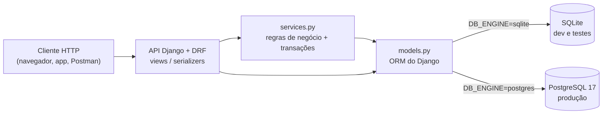

# Documentação — Banco de Dados EasyCar

Esta pasta documenta a camada de **banco de dados** do EasyCar: como ela é organizada,
como roda em desenvolvimento/testes (SQLite) e em produção (PostgreSQL), como o
Docker empacota a aplicação e quais padrões de código seguimos.

## Índice

| Documento | Conteúdo |
|---|---|
| [docker.md](docker.md) | Como o `Dockerfile` e o `docker-compose.yml` funcionam, linha por linha |
| [banco-de-testes.md](banco-de-testes.md) | Banco de testes (SQLite), versões, como rodar e **o que cada teste verifica** |
| [banco-de-producao.md](banco-de-producao.md) | Banco de produção (PostgreSQL), modelo de dados, transações, backup |
| [ci-cd.md](ci-cd.md) | Pipeline do GitHub Actions: lint → testes (SQLite + PostgreSQL) → imagem Docker |
| [padroes-de-codigo.md](padroes-de-codigo.md) | Arquitetura em camadas, boas práticas do ORM, type hints, nomes, erros |
| [alteracoes-da-branch.md](alteracoes-da-branch.md) | O que mudou na branch `feature/banco-de-dados` e por quê |
| [pendencias.md](pendencias.md) | O que ainda falta (do banco e de outras partes do projeto) |

## Visão geral



O acesso ao banco é feito pelo **ORM do Django**: escrevemos Python
(`Carro.objects.filter(...)`) e o Django gera o SQL certo para cada banco. Quem
escolhe qual banco usar é a variável de ambiente `DB_ENGINE`. O código é o mesmo
nos dois.

## Versões utilizadas

Todas fixadas em `requirements.txt` / `requirements-dev.txt` (versões estáveis):

| Tecnologia | Versão | Para quê |
|---|---|---|
| Python | 3.13 (Docker/CI) | Linguagem (funciona também em 3.12 e 3.14) |
| Django | 5.2.19 (LTS, suporte até abril/2028) | Framework web |
| Django REST Framework | 3.18.3 | API REST |
| drf-spectacular | 0.30.0 | Documentação OpenAPI/Swagger |
| python-dotenv | 1.2.4 | Lê o arquivo `.env` |
| psycopg (binary) | 3.3.8 | Driver do PostgreSQL |
| gunicorn | 26.2.0 | Servidor de produção |
| whitenoise | 6.12.0 | Serve arquivos estáticos (admin, Swagger) |
| PostgreSQL | 17 (imagem `postgres:17-alpine`) | Banco de produção |
| SQLite | embutido no Python | Banco de desenvolvimento/testes |
| pytest / pytest-django / pytest-cov | 9.2.0 / 4.14.0 / 7.1.0 | Testes e cobertura |
| ruff | 0.17.4 | Lint |

> Por que Django 5.2 e não 6.x? A 5.2 é **LTS** (Long Term Support): recebe correções
> de segurança por mais tempo e todas as bibliotecas do projeto já a suportam.

## Créditos

Camada de banco de dados, Docker, CI/CD e esta documentação foram feitos com
orientação do **Prof. Henry**.

## Começo rápido

```bash
# 1. Ambiente virtual + dependências
python -m venv .venv
source .venv/bin/activate          # Windows: .venv\Scripts\Activate.ps1
pip install -r requirements-dev.txt

# 2. Variáveis de ambiente (dev usa SQLite)
cp .env.example .env               # Windows: Copy-Item .env.example .env

# 3. Banco + servidor
python manage.py migrate
python manage.py runserver

# 4. Testes
pytest

# 5. Tudo igual à produção (API + PostgreSQL)
docker compose up --build
```
