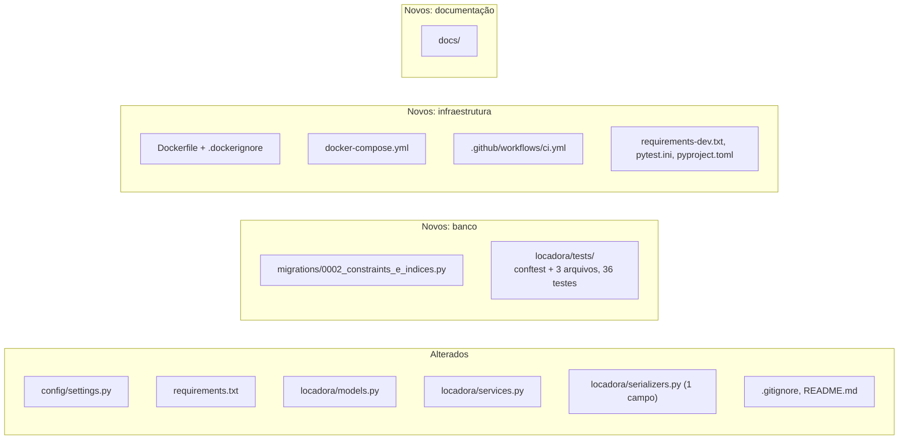

# Alterações da branch `feature/banco-de-dados`

Objetivo: preparar a camada de banco de dados com **SQLite para desenvolvimento/testes**
e **PostgreSQL para produção**, usando o **ORM do Django**, mais Docker e CI.

## Resumo

## Decisão: ORM do Django

O projeto usa o **ORM do Django** para acessar o banco. Uma versão anterior desta
branch tinha uma camada de SQL puro (`locadora/db.py` e `locadora/repositories/`),
que foi **removida** depois dessa decisão. Motivos:

- o projeto já usa models, `ModelSerializer`, `ModelViewSet` e o admin, que dependem do ORM;
- o ORM gera o SQL certo para SQLite e PostgreSQL, sem precisar tratar as diferenças na mão;
- uma camada de SQL puro ao lado do ORM seria código duplicado para manter.

## Arquivos alterados

### `config/settings.py`
| Antes | Depois | Por quê |
|---|---|---|
| Só SQLite | `DB_ENGINE=sqlite` ou `postgres` por variável de ambiente | Um banco para testes, outro para produção, sem mudar código |
| `DEBUG` padrão `1` | padrão `0` | Seguro por padrão: esquecer a variável em produção não liga o modo debug |
| `SECRET_KEY` com valor padrão sempre | só tem padrão com `DEBUG=1`; senão dá erro | Impede subir produção com chave conhecida |
| `ALLOWED_HOSTS` fixo | `DJANGO_ALLOWED_HOSTS` (lista por vírgula) | Permite configurar o domínio real |
| — | `WhiteNoiseMiddleware` + `STATIC_ROOT` | Admin e Swagger com CSS em produção |
| — | `CONN_MAX_AGE`, `CONN_HEALTH_CHECKS` (Postgres) | Reaproveita conexões com segurança |

### `locadora/models.py` + migration `0002_constraints_e_indices`
| Adicionado | Onde | Por quê |
|---|---|---|
| `UniqueConstraint aluguel_um_ativo_por_carro` | `Aluguel` | O banco impede dois aluguéis ativos do mesmo carro |
| `CheckConstraint multa_valor_positivo` | `Multa` | Multa com valor zero/negativo é recusada pelo banco |
| `CheckConstraint multa_dias_atraso_minimo` | `Multa` | Dias de atraso precisa ser ≥ 1 |
| `Index carro_status_idx` | `Carro` | Acelera `/api/carros/?status=disponivel` |
| `Index aluguel_status_idx` | `Aluguel` | Acelera filtros de aluguéis ativos |

Os campos e tabelas **não mudaram**: a migration só adiciona regras e índices.

### `locadora/services.py`
| Função | Mudança |
|---|---|
| todas | type hints em parâmetros e retorno |
| `registrar_aluguel` | sem mudança de comportamento |
| `devolver_carro` | trava o aluguel e confere o status **no banco**, impedindo duas devoluções simultâneas |
| `excluir_aluguel` | aluguel com multa gera `RegraDeNegocio` com mensagem clara, em vez de `ProtectedError` |
| `registrar_multa` | **corrigido**: usava o campo inexistente `descricao` e não preenchia `dias_atrasos` (obrigatório), então quebrava sempre. Agora recebe `valor`, `dias_atrasos`, `motivo` e `data_infracao` por nome. Nenhuma view a chamava ainda |

### `locadora/serializers.py`
Só uma correção: `'descricao'` → `'motivo'` no `MultaSerializer`. O campo não
existia no model e quebrava o CI e o Swagger.

### `requirements.txt`
Versões fixadas (`==`) em releases estáveis e adicionados `psycopg[binary]`,
`gunicorn` e `whitenoise`. Tabela completa em [README.md](README.md#versões-utilizadas).

### Outros
- `.gitignore`: `staticfiles/`, `.pytest_cache/`, `.coverage`, `htmlcov/`.
- `README.md`: descrição do projeto, como rodar, link para `docs/`.

## Arquivos novos

| Arquivo | O que é |
|---|---|
| `locadora/migrations/0002_constraints_e_indices.py` | Constraints e índices novos |
| `locadora/tests/conftest.py` | Fixtures: funcionário, cliente, perfil, carro, aluguel |
| `locadora/tests/test_models.py` | 20 testes das regras do banco |
| `locadora/tests/test_services.py` | 14 testes das regras de negócio |
| `locadora/tests/test_serializers_banco.py` | 2 testes de API × banco |
| `Dockerfile`, `.dockerignore` | Imagem de produção ([docker.md](docker.md)) |
| `docker-compose.yml` | API + PostgreSQL local ([docker.md](docker.md)) |
| `.github/workflows/ci.yml` | Pipeline ([ci-cd.md](ci-cd.md)) |
| `requirements-dev.txt` | pytest, pytest-django, pytest-cov, ruff |
| `pytest.ini` | Configuração do pytest + cobertura |
| `pyproject.toml` | Configuração do ruff |
| `docs/` | Esta documentação |

## O que NÃO foi alterado

- `views.py`, `admin.py`, `permissions.py`, `urls.py`: iguais ao original.
- Migration `0001_initial`: intacta.
- `.env.example`: mantido. As novas variáveis estão documentadas em
  [banco-de-producao.md](banco-de-producao.md#variáveis-de-ambiente).

## Validação

| Verificação | Resultado |
|---|---|
| `ruff check .` | sem erros |
| `pytest` no SQLite | 36 passando |
| `pytest` no PostgreSQL 17 | 36 passando |
| `manage.py makemigrations --check` | nenhuma migration pendente |
| `manage.py check --deploy` | sem erros, só avisos de HTTPS (ver pendências) |
| Geração do Swagger (`manage.py spectacular`) | ok |
| `docker compose up --build` | API 200, estáticos 200, rota protegida 401 |

## Impacto para o time

- Depois de puxar a branch: `pip install -r requirements-dev.txt` e `python manage.py migrate`.
- Quem roda localmente precisa do `.env` (copiado do `.env.example`, que já tem
  `DJANGO_DEBUG=1`). Sem ele, o Django pede a `DJANGO_SECRET_KEY`.
- Se o `db.sqlite3` local tiver **dois aluguéis ativos do mesmo carro** ou **multa com
  valor ≤ 0 / dias de atraso 0**, a migration `0002` falha. Corrija esses registros
  ou apague o `db.sqlite3` (é só de desenvolvimento) e rode `migrate` de novo.
