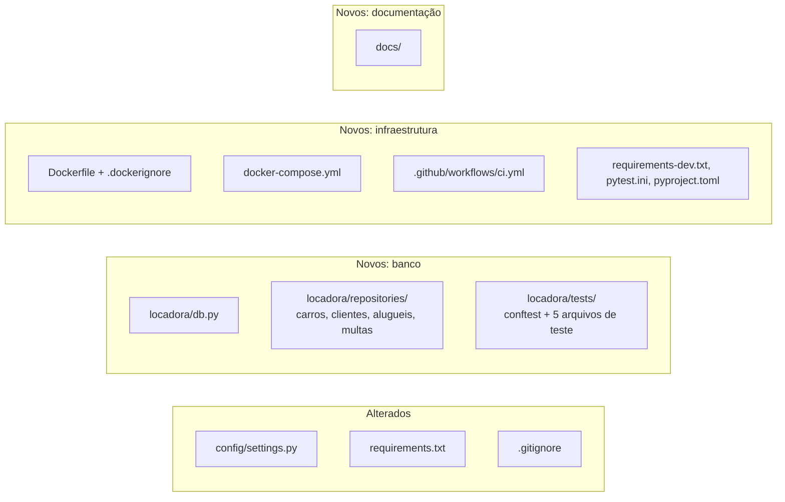

# Alterações da branch `feature/banco-de-dados`

Objetivo: preparar a camada de banco de dados com **SQLite para desenvolvimento/testes**
e **PostgreSQL para produção**, acesso a dados **sem ORM**, Docker e CI.

## Resumo

## Arquivos alterados

### `config/settings.py`
| Antes | Depois | Por quê |
|---|---|---|
| Só SQLite | `DB_ENGINE=sqlite` ou `postgres` por variável de ambiente | Um banco para testes, outro para produção, sem mudar código |
| `DEBUG` padrão `1` | padrão `0` | Seguro por padrão: esquecer a variável em produção não liga o modo debug |
| `SECRET_KEY` com valor padrão sempre | só tem padrão com `DEBUG=1`; senão dá erro | Impede subir produção com chave conhecida |
| `ALLOWED_HOSTS` fixo | `DJANGO_ALLOWED_HOSTS` (lista por vírgula) | Permite configurar o domínio real |
| — | `WhiteNoiseMiddleware` + `STATIC_ROOT` | Admin e Swagger com CSS em produção |
| — | `CONN_MAX_AGE`, `CONN_HEALTH_CHECKS` (Postgres) | Reaproveita conexões com segurança |

### `requirements.txt`
Versões fixadas (`==`) em releases estáveis e adicionados `psycopg[binary]`,
`gunicorn` e `whitenoise`. Tabela completa em [README.md](README.md#versões-utilizadas).

### `.gitignore`
Adicionados `staticfiles/`, `.pytest_cache/`, `.coverage`, `htmlcov/`.

## Arquivos novos

| Arquivo | O que é |
|---|---|
| `locadora/db.py` | Funções base de SQL puro: `buscar_todos`, `buscar_um`, `buscar_valor`, `executar`, `for_update`, `para_decimal` |
| `locadora/repositories/carros.py` | CRUD de carros, status, paginação, `tem_alugueis` |
| `locadora/repositories/clientes.py` | Perfis de cliente com JOIN em `auth_user`, carros já alugados |
| `locadora/repositories/alugueis.py` | Criar, listar com filtros, finalizar (protegido contra devolução dupla), excluir |
| `locadora/repositories/multas.py` | Criar, listar por cliente, pagar, abonar, excluir |
| `locadora/tests/conftest.py` | Fixtures: funcionário, cliente, perfil, carro, aluguel |
| `locadora/tests/test_*.py` | 35 testes (detalhes em [banco-de-testes.md](banco-de-testes.md)) |
| `Dockerfile`, `.dockerignore` | Imagem de produção ([docker.md](docker.md)) |
| `docker-compose.yml` | API + PostgreSQL local ([docker.md](docker.md)) |
| `.github/workflows/ci.yml` | Pipeline ([ci-cd.md](ci-cd.md)) |
| `requirements-dev.txt` | pytest, pytest-django, pytest-cov, ruff |
| `pytest.ini` | Configuração do pytest + cobertura |
| `pyproject.toml` | Configuração do ruff |
| `docs/` | Esta documentação |

## O que NÃO foi alterado

- `models.py`, `migrations/`: as tabelas continuam as mesmas. Os repositórios leem e
  escrevem nas tabelas que já existem (`locadora_carro`, `locadora_aluguel`...).
- `views.py`, `serializers.py`, `services.py`, `admin.py`, `permissions.py`, `urls.py`:
  continuam como estavam. Dá para migrá-los para os repositórios aos poucos, uma view
  por vez (ver [pendencias.md](pendencias.md)).
- `.env.example`: mantido. As novas variáveis estão documentadas em
  [banco-de-producao.md](banco-de-producao.md#variáveis-de-ambiente).

## Validação

| Verificação | Resultado |
|---|---|
| `ruff check .` | sem erros |
| `pytest` no SQLite | 35 passando |
| `pytest` no PostgreSQL 17 | 35 passando |
| `manage.py makemigrations --check` | nenhuma migration pendente |
| `manage.py check --deploy` | só avisos de HTTPS (ver pendências) |
| `docker compose up --build` | API 200, estáticos 200, rota protegida 401 |

## Impacto para o time

- Quem roda localmente precisa ter o `.env` (copiado do `.env.example`, que já tem
  `DJANGO_DEBUG=1`). Sem ele, o Django pede a `DJANGO_SECRET_KEY`.
- Depois de puxar a branch: `pip install -r requirements-dev.txt`.
