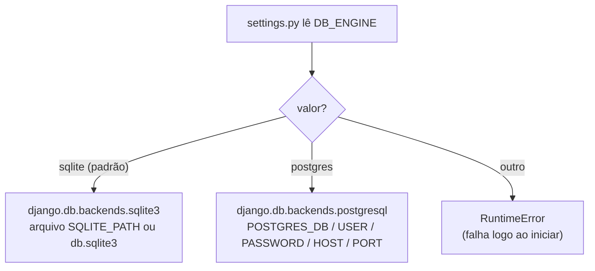
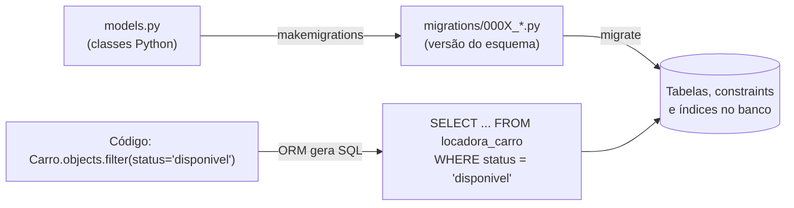
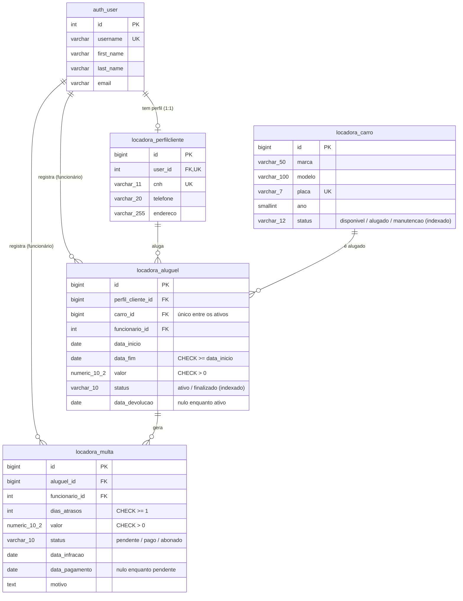
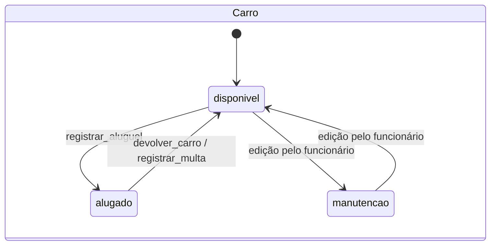
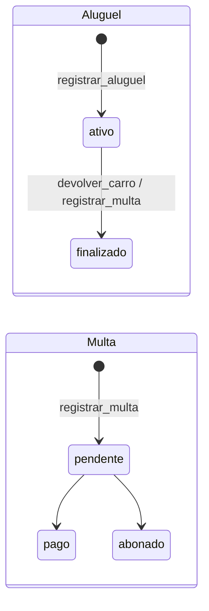
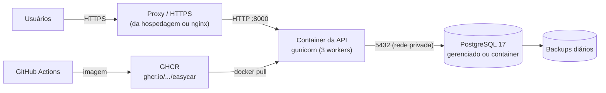

# Banco de produção (PostgreSQL)

Em produção usamos **PostgreSQL 17**: aguenta muitos acessos simultâneos, trava
linhas individuais (`SELECT ... FOR UPDATE`), tem tipos de dados exatos (`numeric`,
`date`) e ferramentas de backup. O acesso é feito pelo **ORM do Django**, o mesmo
código usado com SQLite nos testes.

## Como a aplicação escolhe o banco

Em `config/settings.py`:



No PostgreSQL também estão ligados:
- `CONN_MAX_AGE = 60`: reaproveita a conexão por até 60 s, em vez de abrir uma nova a cada requisição;
- `CONN_HEALTH_CHECKS = True`: antes de reaproveitar, confere se a conexão ainda está viva.

## Variáveis de ambiente

| Variável | Exemplo | Obrigatória em produção | Descrição |
|---|---|---|---|
| `DJANGO_SECRET_KEY` | (string longa e aleatória) | **sim** | Chave secreta do Django, usada para assinar sessões e tokens. Sem ela e com `DEBUG=0`, a aplicação não sobe |
| `DJANGO_DEBUG` | `0` | sim | `1` só em desenvolvimento. O padrão é `0` (seguro) |
| `DJANGO_ALLOWED_HOSTS` | `api.easycar.com.br` | sim | Domínios aceitos, separados por vírgula |
| `DB_ENGINE` | `postgres` | sim | `sqlite` ou `postgres` |
| `POSTGRES_DB` | `easycar` | sim | Nome do banco |
| `POSTGRES_USER` | `easycar` | sim | Usuário do banco |
| `POSTGRES_PASSWORD` | (segredo) | **sim** | Senha do banco |
| `POSTGRES_HOST` | `db` / IP / host gerenciado | sim | Endereço do servidor |
| `POSTGRES_PORT` | `5432` | não | Porta (padrão 5432) |
| `SQLITE_PATH` | `db.sqlite3` | não | Só quando `DB_ENGINE=sqlite` |

Para gerar uma `DJANGO_SECRET_KEY`:
```bash
python -c "from django.core.management.utils import get_random_secret_key as k; print(k())"
```

> Nunca coloque senhas reais no Git. O `.env` está no `.gitignore`. No servidor,
> use as variáveis/segredos da hospedagem.

## Como o ORM conversa com o banco



- **`models.py`** descreve as tabelas em Python.
- **`makemigrations`** compara os models com as migrations e gera um arquivo novo
  com as diferenças. Esse arquivo **vai para o Git**.
- **`migrate`** aplica no banco as migrations que ainda não foram aplicadas. No
  Docker isso roda sozinho ao subir o container.
- O Django guarda o que já foi aplicado na tabela `django_migrations`.

Migrations do projeto:

| Migration | O que faz |
|---|---|
| `0001_initial` | Cria as tabelas `locadora_carro`, `locadora_perfilcliente`, `locadora_aluguel`, `locadora_multa` |
| `0002_constraints_e_indices` | Índices em `status` (carro e aluguel), "um aluguel ativo por carro", `CHECK` de valor e dias de atraso da multa |

Para ver o SQL que uma migration gera no PostgreSQL (precisa do banco no ar):
```bash
DB_ENGINE=postgres python manage.py sqlmigrate locadora 0002
```

## Modelo de dados



Relações:
- **1:1**: `auth_user` ↔ `locadora_perfilcliente` (um usuário cliente tem um perfil).
- **1:N**: funcionário → aluguéis; funcionário → multas; aluguel → multas.
- **N:N**: cliente ↔ carro, usando `locadora_aluguel` como tabela intermediária
  (`PerfilCliente.carros = ManyToManyField(through='Aluguel')`).

### Regras garantidas

| Regra | Onde | Quem garante |
|---|---|---|
| Placa única | `Carro.placa unique=True` | banco (`UNIQUE`) |
| CNH única | `PerfilCliente.cnh unique=True` | banco (`UNIQUE`) |
| Um perfil por usuário | `OneToOneField` | banco (`UNIQUE`) |
| Fim do aluguel ≥ início | `CheckConstraint aluguel_fim_depois_do_inicio` | banco (`CHECK`) |
| Valor do aluguel > 0 | `CheckConstraint aluguel_valor_positivo` | banco (`CHECK`) |
| **Um aluguel ativo por carro** | `UniqueConstraint aluguel_um_ativo_por_carro` (condição `status='ativo'`) | banco (índice único parcial) |
| Valor da multa > 0 | `CheckConstraint multa_valor_positivo` | banco (`CHECK`) |
| Dias de atraso ≥ 1 | `CheckConstraint multa_dias_atraso_minimo` | banco (`CHECK`) |
| Não apagar carro/cliente/funcionário/aluguel com histórico | `on_delete=PROTECT` | Django (ORM) |
| Apagar usuário apaga o perfil | `on_delete=CASCADE` | Django (ORM) |
| Status do carro acompanha o aluguel | `services.py` | código, em transação |

> As regras de `CHECK`/`UNIQUE` valem **mesmo se alguém pular a API** (admin,
> shell, script). O `PROTECT`/`CASCADE` é aplicado pelo ORM, então funciona sempre
> que o acesso passa pelo Django.

## Ciclo de vida dos status





## Transações e concorrência

Toda operação que mexe em mais de uma tabela está em `services.py`, dentro de
`@transaction.atomic`: ou grava **tudo**, ou **nada**. Exemplo:
`registrar_multa` cria a multa, finaliza o aluguel e libera o carro. Se qualquer
passo falhar, os outros são desfeitos.

As linhas envolvidas são travadas com `select_for_update()`. Quando dois
funcionários tentam alugar o mesmo carro no mesmo instante:

```mermaid
sequenceDiagram
    participant F1 as Funcionário 1
    participant F2 as Funcionário 2
    participant PG as PostgreSQL
    F1->>PG: BEGIN
    F1->>PG: Carro.objects.select_for_update().get(pk=7)
    PG-->>F1: status = disponivel (linha TRAVADA)
    F2->>PG: BEGIN
    F2->>PG: Carro.objects.select_for_update().get(pk=7)
    Note over F2,PG: F2 fica esperando a trava
    F1->>PG: Aluguel.objects.create(...)
    F1->>PG: carro.status = 'alugado'; carro.save()
    F1->>PG: COMMIT (libera a trava)
    PG-->>F2: status = alugado
    F2->>F2: RegraDeNegocio → HTTP 409
    F2->>PG: ROLLBACK
```

Se mesmo assim algo escapar, a constraint `aluguel_um_ativo_por_carro` recusa o
segundo aluguel ativo no próprio banco.

O código correspondente (`locadora/services.py`):

```python
@transaction.atomic
def registrar_aluguel(dados: dict[str, Any], funcionario: User) -> Aluguel:
    carro = Carro.objects.select_for_update().get(pk=dados['carro'].pk)
    if carro.status != Carro.Status.DISPONIVEL:
        raise RegraDeNegocio(f'O carro {carro.placa} não está disponível (...).')
    aluguel = Aluguel.objects.create(funcionario=funcionario, **{**dados, 'carro': carro})
    carro.status = Carro.Status.ALUGADO
    carro.save(update_fields=['status'])
    return aluguel
```

Na devolução e na multa, o service relê o status **do banco** (travando a linha)
em vez de confiar no objeto em memória. Assim, se outra requisição acabou de
finalizar o aluguel, a segunda é recusada.

## Arquitetura de produção sugerida



- O PostgreSQL **não** deve ficar exposto na internet: só a API acessa.
- O HTTPS fica no proxy/hospedagem. Depois de ativado, ligue no `settings.py`:
  `SECURE_PROXY_SSL_HEADER`, `SESSION_COOKIE_SECURE`, `CSRF_COOKIE_SECURE` e
  `SECURE_SSL_REDIRECT` (o `manage.py check --deploy` lista o que falta).

## Backup e restauração

```bash
# Backup (formato compactado)
docker compose exec db pg_dump -U easycar -d easycar -Fc > backup_$(date +%F).dump

# Restaurar
docker compose exec -T db pg_restore -U easycar -d easycar --clean < backup_2026-11-09.dump
```

## Checklist de deploy

- [ ] `DJANGO_DEBUG=0`
- [ ] `DJANGO_SECRET_KEY` nova e secreta
- [ ] `DJANGO_ALLOWED_HOSTS` com o domínio real
- [ ] Senha forte em `POSTGRES_PASSWORD`
- [ ] Banco acessível só pela API (rede privada)
- [ ] HTTPS ativo + configurações `SECURE_*`
- [ ] Backup automático configurado
- [ ] `python manage.py check --deploy` sem avisos
- [ ] `python manage.py migrate` aplicado (o container já faz ao subir)
- [ ] `python manage.py createsuperuser` para o primeiro admin
- [ ] Grupos `Funcionários` e `Clientes` criados no admin
