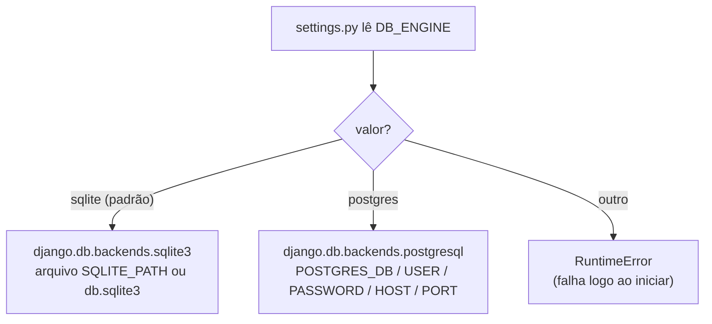
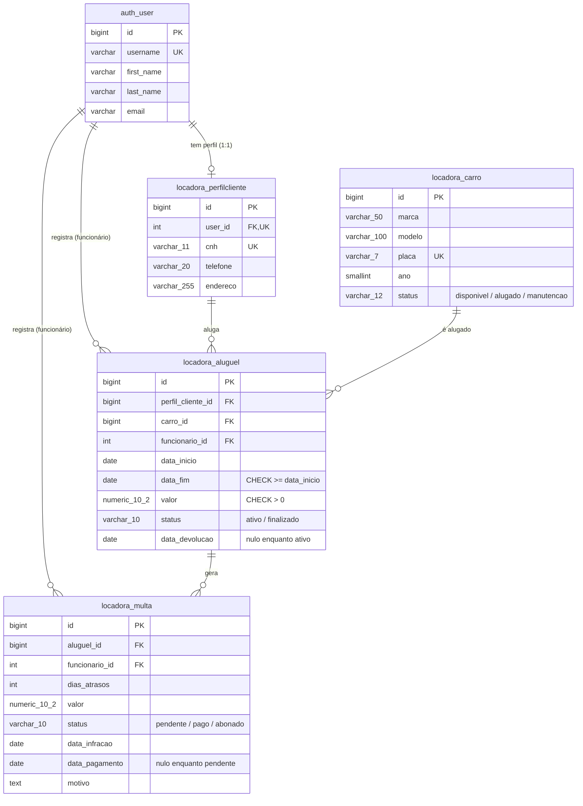
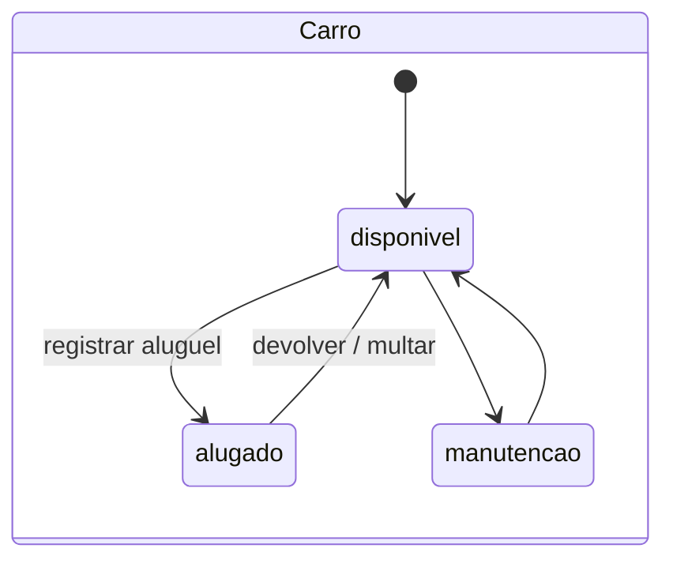
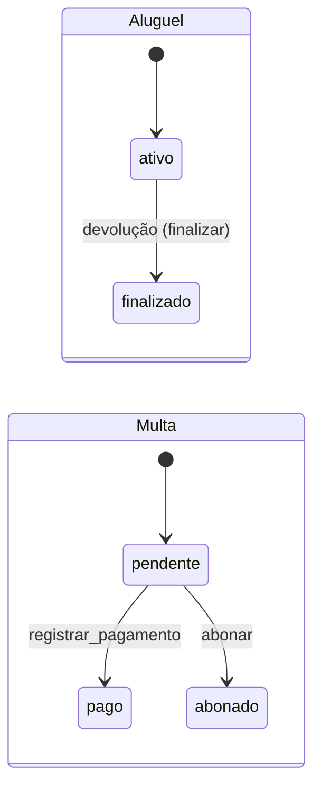
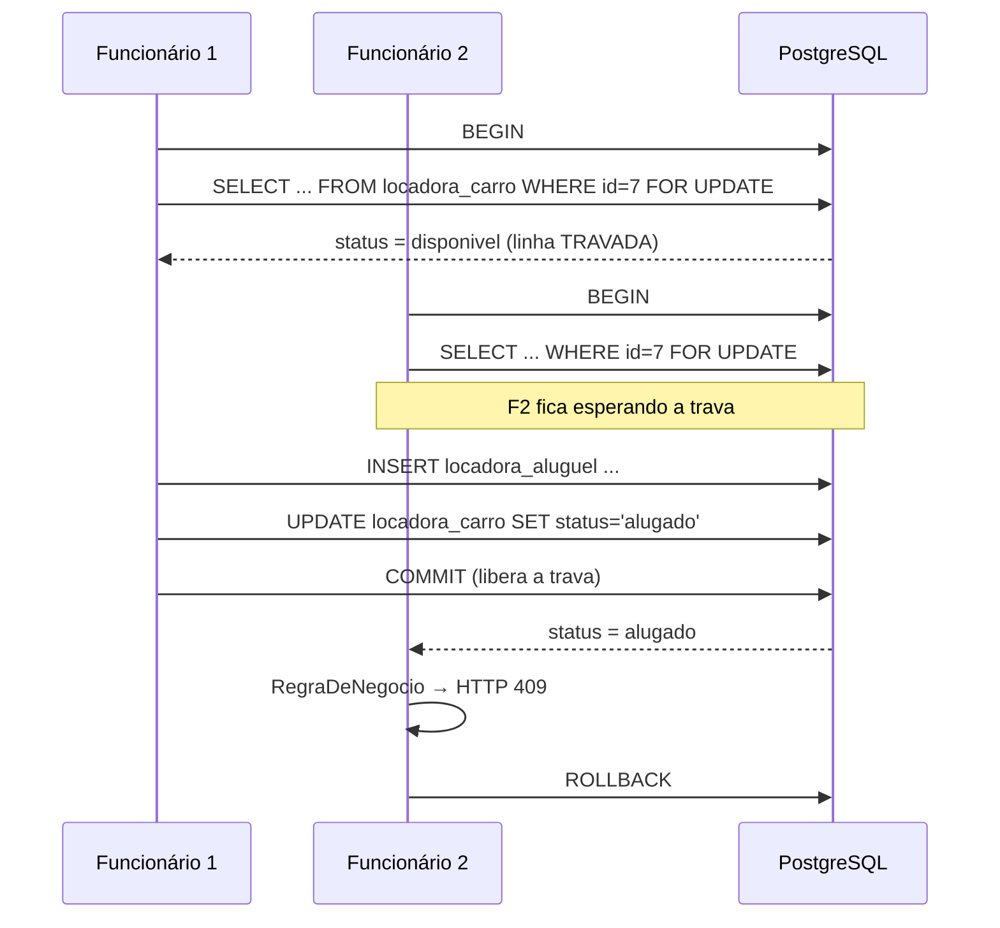
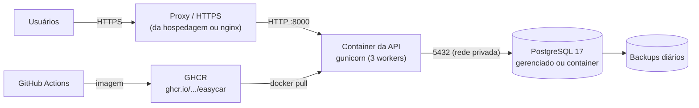

# Banco de produção (PostgreSQL)

Em produção usamos **PostgreSQL 17**: aguenta muitos acessos simultâneos, tem
travamento por linha (`FOR UPDATE`), tipos de dados reais (`numeric`, `date`) e
ferramentas de backup.

## Como a aplicação escolhe o banco

Em `config/settings.py`:



No PostgreSQL também estão ligados:
- `CONN_MAX_AGE = 60`: reaproveita a conexão por até 60 s, em vez de abrir uma nova a cada requisição;
- `CONN_HEALTH_CHECKS = True`: antes de reaproveitar, confere se a conexão ainda está viva.

## Variáveis de ambiente

| Variável | Exemplo | Obrigatória em produção | Descrição |
|---|---|---|---|
| `DJANGO_SECRET_KEY` | (string longa e aleatória) | **sim** | Chave de criptografia do Django. Sem ela e com `DEBUG=0`, a aplicação não sobe |
| `DJANGO_DEBUG` | `0` | sim | `1` só em desenvolvimento. O padrão é `0` (seguro) |
| `DJANGO_ALLOWED_HOSTS` | `api.easycar.com.br` | sim | Domínios aceitos, separados por vírgula |
| `DB_ENGINE` | `postgres` | sim | `sqlite` ou `postgres` |
| `POSTGRES_DB` | `easycar` | sim | Nome do banco |
| `POSTGRES_USER` | `easycar` | sim | Usuário do banco |
| `POSTGRES_PASSWORD` | (segredo) | **sim** | Senha do banco |
| `POSTGRES_HOST` | `db` / IP / host gerenciado | sim | Endereço do servidor |
| `POSTGRES_PORT` | `5432` | não | Porta (padrão 5432) |
| `SQLITE_PATH` | `db.sqlite3` | não | Só quando `DB_ENGINE=sqlite` |

Para gerar uma `DJANGO_SECRET_KEY`:
```bash
python -c "from django.core.management.utils import get_random_secret_key as k; print(k())"
```

> Nunca coloque senhas reais no Git. O `.env` está no `.gitignore`. No servidor,
> use as variáveis/segredos da hospedagem.

## Modelo de dados



Relações:
- **1:1**: `auth_user` ↔ `locadora_perfilcliente` (um usuário cliente tem um perfil).
- **1:N**: funcionário → aluguéis; funcionário → multas; aluguel → multas.
- **N:N**: cliente ↔ carro, usando `locadora_aluguel` como tabela intermediária.

### Regras garantidas pelo próprio banco

| Regra | Onde |
|---|---|
| Placa única | `UNIQUE (placa)` em `locadora_carro` |
| CNH única | `UNIQUE (cnh)` em `locadora_perfilcliente` |
| Um perfil por usuário | `UNIQUE (user_id)` em `locadora_perfilcliente` |
| Fim do aluguel ≥ início | `CHECK aluguel_fim_depois_do_inicio` |
| Valor do aluguel > 0 | `CHECK aluguel_valor_positivo` |
| Chaves estrangeiras válidas | `FOREIGN KEY ... DEFERRABLE INITIALLY DEFERRED` |

> ⚠️ O `on_delete=PROTECT`/`CASCADE` dos models é aplicado pelo **Django em Python**,
> não pelo banco. Com SQL puro, um `DELETE` de um carro com aluguéis só falha no
> `COMMIT`. Por isso os repositórios têm `tem_alugueis()`/`tem_multas()`: o service
> deve consultar antes de excluir.

Para ver o SQL exato que cria as tabelas no PostgreSQL:
```bash
DB_ENGINE=postgres python manage.py sqlmigrate locadora 0001
```

## Ciclo de vida dos status





Os `UPDATE` de mudança de status têm a condição do estado atual no `WHERE`
(ex.: `... WHERE id = %s AND status = 'ativo'`). Se duas pessoas tentarem
finalizar o mesmo aluguel ao mesmo tempo, só uma consegue (`rowcount = 1`) e a
outra recebe `0`.

## Concorrência: alugar o mesmo carro ao mesmo tempo

Sem trava, dois funcionários poderiam alugar o mesmo carro no mesmo instante. Com
`transaction.atomic()` + `buscar_por_id(..., bloquear=True)` (que gera `FOR UPDATE`):



Exemplo de service usando os repositórios:

```python
from django.db import transaction
from locadora.repositories import alugueis, carros


@transaction.atomic
def registrar_aluguel(perfil_id: int, carro_id: int, funcionario_id: int,
                      inicio: date, fim: date, valor: Decimal) -> AluguelLinha:
    carro = carros.buscar_por_id(carro_id, bloquear=True)
    if carro is None:
        raise RegraDeNegocio('Carro não encontrado.')
    if carro['status'] != 'disponivel':
        raise RegraDeNegocio(f"O carro {carro['placa']} não está disponível.")
    aluguel = alugueis.criar(perfil_id, carro_id, funcionario_id, inicio, fim, valor)
    carros.atualizar_status(carro_id, 'alugado')
    return aluguel
```

## Arquitetura de produção sugerida



- O PostgreSQL **não** deve ficar exposto na internet: só a API acessa.
- O HTTPS fica no proxy/hospedagem. Depois de ativado, ligue no `settings.py`:
  `SECURE_PROXY_SSL_HEADER`, `SESSION_COOKIE_SECURE`, `CSRF_COOKIE_SECURE` e
  `SECURE_SSL_REDIRECT` (o `manage.py check --deploy` lista o que falta).

## Backup e restauração

```bash
# Backup (formato compactado)
docker compose exec db pg_dump -U easycar -d easycar -Fc > backup_$(date +%F).dump

# Restaurar
docker compose exec -T db pg_restore -U easycar -d easycar --clean < backup_2026-11-09.dump
```

## Checklist de deploy

- [ ] `DJANGO_DEBUG=0`
- [ ] `DJANGO_SECRET_KEY` nova e secreta
- [ ] `DJANGO_ALLOWED_HOSTS` com o domínio real
- [ ] Senha forte em `POSTGRES_PASSWORD`
- [ ] Banco acessível só pela API (rede privada)
- [ ] HTTPS ativo + configurações `SECURE_*`
- [ ] Backup automático configurado
- [ ] `python manage.py check --deploy` sem avisos
- [ ] `python manage.py createsuperuser` para o primeiro admin
- [ ] Grupos `Funcionários` e `Clientes` criados no admin
