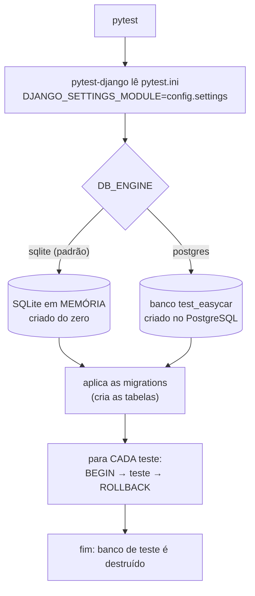
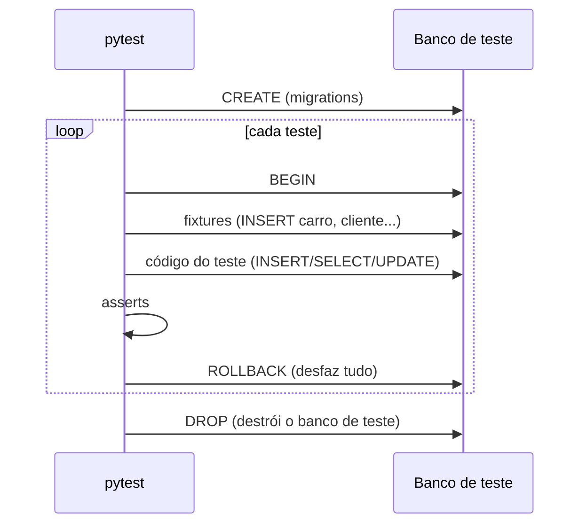

# Banco de testes (SQLite)

Em desenvolvimento e nos testes automatizados usamos **SQLite**: é um banco num
único arquivo (ou só na memória), já vem com o Python e não precisa instalar nem
configurar servidor nenhum.

Os testes rodam **também no PostgreSQL** (no CI e, se quiser, localmente). O SQLite
aceita algumas coisas que o PostgreSQL recusa, e o contrário também acontece. Rodar
nos dois garante que o SQL que escrevemos funciona em produção.

## Versões

| Item | Versão |
|---|---|
| SQLite | o embutido no Python (precisa ser ≥ 3.35 por causa do `RETURNING`; Python 3.12+ já atende) |
| pytest | 9.2.0 |
| pytest-django | 4.14.0 |
| pytest-cov | 7.1.0 |
| PostgreSQL (CI / teste local opcional) | 17 |

Para ver a versão do SQLite do seu Python:
```bash
python -c "import sqlite3; print(sqlite3.sqlite_version)"
```

## Como o banco de testes funciona



Pontos importantes:

1. **O banco de teste nunca é o seu `db.sqlite3`.** O pytest-django cria um banco
   separado (no SQLite, na memória; no PostgreSQL, um banco `test_<nome>`) e o apaga
   no final. Seus dados de desenvolvimento ficam intactos.
2. **Cada teste começa com o banco vazio.** Os testes marcados com
   `pytestmark = pytest.mark.django_db` rodam dentro de uma transação que é
   desfeita (*ROLLBACK*) ao final. Nada vaza de um teste para o outro.
3. **Fixtures** (`locadora/tests/conftest.py`) criam os dados de que cada teste
   precisa (usuário, carro, perfil, aluguel), sempre do zero.



## Como rodar

```bash
# SQLite (padrão, rápido)
pytest

# Sem relatório de cobertura
pytest --no-cov

# Um arquivo / um teste específico
pytest locadora/tests/test_repo_alugueis.py
pytest -k finalizar_so_uma_vez

# Contra PostgreSQL local (sobe um Postgres temporário na porta 55432)
docker run -d --rm --name pg-teste -e POSTGRES_DB=easycar -e POSTGRES_USER=easycar \
  -e POSTGRES_PASSWORD=easycar -p 55432:5432 postgres:17-alpine
DB_ENGINE=postgres POSTGRES_PASSWORD=easycar POSTGRES_PORT=55432 pytest
docker stop pg-teste
```

> Se aparecer `RuntimeError: Defina DJANGO_SECRET_KEY`, falta o arquivo `.env`
> (copie o `.env.example`) ou exporte `DJANGO_DEBUG=1`.

## Resultado atual

| Banco | Resultado |
|---|---|
| SQLite | **35 testes passando** |
| PostgreSQL 17 | **35 testes passando** |

Cobertura dos arquivos do banco: `db.py` 100%, `repositories/alugueis.py` 100%,
`repositories/carros.py` 100%, `repositories/clientes.py` 97%, `repositories/multas.py` 96%.

## O que cada teste verifica

### `test_db.py` — funções base (`locadora/db.py`)

| Teste | O que garante |
|---|---|
| `test_buscar_um_sem_resultado_devolve_none` | Busca sem resultado devolve `None` (e não erro) |
| `test_buscar_valor` | `buscar_valor` devolve um valor único (ex.: `COUNT(*)`) |
| `test_for_update_depende_do_banco` | `FOR UPDATE` só é gerado no PostgreSQL; no SQLite vira string vazia |
| `test_para_decimal_normaliza_dinheiro` (4 casos) | Dinheiro sempre volta como `Decimal` com 2 casas, venha `int`, `float` ou `Decimal` |
| `test_parametros_impedem_sql_injection` | Um texto malicioso (`x' OR '1'='1`) é tratado como valor, não como SQL |

### `test_repo_carros.py` — tabela `locadora_carro`

| Teste | O que garante |
|---|---|
| `test_criar_devolve_linha_completa` | `INSERT ... RETURNING` devolve a linha com `id` e status `disponivel` |
| `test_buscar_por_placa` | Busca pela placa; placa inexistente → `None` |
| `test_listar_ordena_e_filtra_por_status` | Ordem por modelo/placa, filtro por status e `contar()` |
| `test_listar_pagina` | `LIMIT`/`OFFSET` (paginação) |
| `test_atualizar_dados` | `UPDATE` dos dados cadastrais |
| `test_placa_duplicada_viola_unique` | O banco recusa placa repetida (`UNIQUE`) |
| `test_bloquear_funciona_nos_dois_bancos` | `SELECT ... FOR UPDATE` não quebra no SQLite e trava no PostgreSQL |
| `test_tem_alugueis` | Detecta se o carro tem aluguéis (o banco não aplica o PROTECT do Django) |
| `test_excluir` | `DELETE` remove o carro |

### `test_repo_clientes.py` — tabela `locadora_perfilcliente`

| Teste | O que garante |
|---|---|
| `test_criar_e_buscar_com_dados_do_usuario` | `JOIN` com `auth_user` traz username/nome; buscas por id, usuário e CNH |
| `test_cnh_duplicada_viola_unique` | O banco recusa CNH repetida |
| `test_um_perfil_por_usuario` | Um usuário só pode ter um perfil (relação 1:1) |
| `test_listar_ordena_por_username` | Lista em ordem alfabética de username |
| `test_atualizar` | Atualiza telefone e endereço |
| `test_carros_alugados_sem_repetir` | Carros já alugados pelo cliente, sem duplicar (`DISTINCT`) |

### `test_repo_alugueis.py` — tabela `locadora_aluguel`

| Teste | O que garante |
|---|---|
| `test_criar_comeca_ativo_e_valor_e_decimal` | Aluguel nasce `ativo`, sem devolução, valor em `Decimal` |
| `test_datas_voltam_como_date` | Datas voltam como `datetime.date` nos dois bancos (não como texto) |
| `test_check_fim_antes_do_inicio` | `CHECK`: data de fim não pode ser antes do início |
| `test_check_valor_positivo` | `CHECK`: valor tem que ser maior que zero |
| `test_finalizar_so_uma_vez` | Uma 2ª devolução não altera nada (proteção contra devolução dupla) |
| `test_listar_com_filtros` | Filtros por cliente, carro e status |
| `test_bloquear_e_excluir` | Trava de linha, `tem_multas` e exclusão |

### `test_repo_multas.py` — tabela `locadora_multa`

| Teste | O que garante |
|---|---|
| `test_criar_comeca_pendente` | Multa nasce `pendente`, valor em `Decimal`, aluguel passa a "ter multas" |
| `test_pagar_so_se_pendente` | Só paga multa pendente; não paga duas vezes nem abona depois de paga |
| `test_abonar` | Pendente → abonado |
| `test_listar_por_cliente_e_status` | Multas de um cliente (via `JOIN` com aluguel) e por status |
| `test_excluir` | `DELETE` remove a multa |

## Diferenças SQLite × PostgreSQL que os testes cobrem

| Assunto | SQLite | PostgreSQL | Como tratamos |
|---|---|---|---|
| Placeholder | `?` | `%s` | Escrevemos sempre `%s`; o Django converte |
| `SELECT ... FOR UPDATE` | não existe (erro de sintaxe) | trava a linha | `db.for_update()` |
| Tipo decimal | não tem; vira `int`/`float` | `numeric` → `Decimal` | `db.para_decimal()` |
| Datas | texto, convertido pelo Django | `date` nativo | testado em `test_datas_voltam_como_date` |
| `RETURNING` | a partir do 3.35 | sempre | usado em todos os `criar()` |
| `CHECK` / `UNIQUE` | aplica | aplica | testes de `IntegrityError` |
| Chave estrangeira | o Django cria como `DEFERRABLE INITIALLY DEFERRED` (checada só no COMMIT) | igual | por isso os repositórios têm `tem_alugueis()`/`tem_multas()` antes de excluir |

## Como escrever um novo teste

```python
import pytest
from locadora.repositories import carros

pytestmark = pytest.mark.django_db   # libera acesso ao banco


def test_algo(carro):                # 'carro' vem do conftest.py
    carros.atualizar_status(carro['id'], 'manutencao')
    assert carros.buscar_por_id(carro['id'])['status'] == 'manutencao'
```

Para testar um erro do banco, use `transaction.atomic()` em volta. Sem ele, a
transação do teste fica "quebrada" no PostgreSQL:

```python
from django.db import IntegrityError, transaction

with pytest.raises(IntegrityError), transaction.atomic():
    carros.criar('Fiat', 'Uno', 'ABC1D23', 2020)   # placa repetida
```
