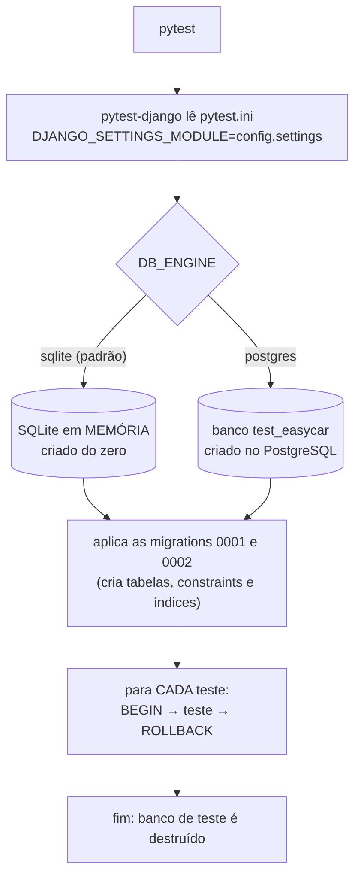
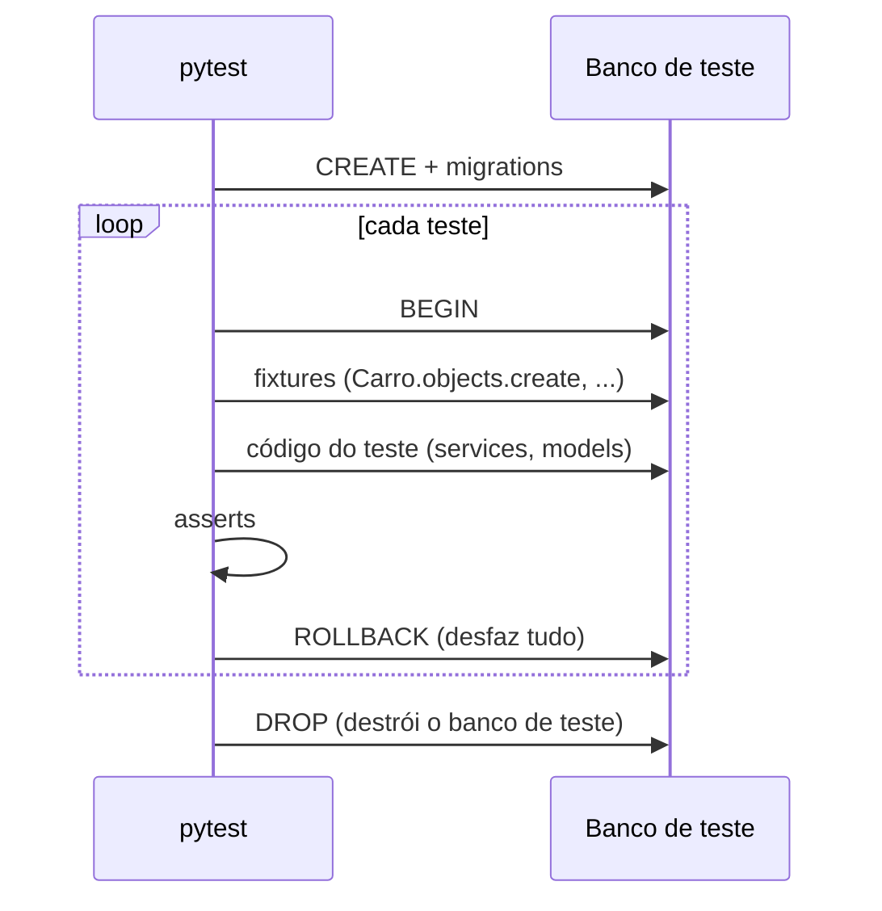

# Banco de testes (SQLite)

Em desenvolvimento e nos testes automatizados usamos **SQLite**: é um banco num
único arquivo (ou só na memória), já vem com o Python e não precisa instalar nem
configurar servidor nenhum.

Os testes rodam **também no PostgreSQL** (no CI e, se quiser, localmente). O ORM do
Django gera SQL diferente para cada banco, e algumas coisas se comportam de jeito
diferente (por exemplo, `select_for_update` só trava de verdade no PostgreSQL).
Rodar nos dois garante que o que passa aqui funciona em produção.

## Versões

| Item | Versão |
|---|---|
| SQLite | o embutido no Python |
| pytest | 9.2.0 |
| pytest-django | 4.14.0 |
| pytest-cov | 7.1.0 |
| PostgreSQL (CI / teste local opcional) | 17 |

Para ver a versão do SQLite do seu Python:
```bash
python -c "import sqlite3; print(sqlite3.sqlite_version)"
```

## Como o banco de testes funciona



Pontos importantes:

1. **O banco de teste nunca é o seu `db.sqlite3`.** O pytest-django cria um banco
   separado (no SQLite, na memória; no PostgreSQL, um banco `test_<nome>`) e o apaga
   no final. Seus dados de desenvolvimento ficam intactos.
2. **As migrations rodam antes dos testes.** Se uma migration estiver quebrada, os
   testes nem começam. É mais uma garantia.
3. **Cada teste começa com o banco vazio.** Os testes marcados com
   `pytestmark = pytest.mark.django_db` rodam dentro de uma transação que é
   desfeita (*ROLLBACK*) ao final. Nada vaza de um teste para o outro.
4. **Fixtures** (`locadora/tests/conftest.py`) criam os dados de que cada teste
   precisa, sempre do zero:

| Fixture | O que cria |
|---|---|
| `funcionario` | usuário `func` |
| `usuario_cliente` | usuária `maria` (Maria Silva) |
| `perfil` | `PerfilCliente` da Maria (CNH 12345678901) |
| `carro` | Fiat Uno, placa `ABC1D23`, disponível |
| `dados_aluguel` | dicionário com cliente, carro, datas e valor (R$ 350,00) |
| `aluguel` | aluguel **ativo** criado pelo service (o carro fica "alugado") |



## Como rodar

```bash
# SQLite (padrão, rápido)
pytest

# Sem relatório de cobertura
pytest --no-cov

# Um arquivo / um teste específico
pytest locadora/tests/test_services.py
pytest -k nao_devolve_duas_vezes

# Contra PostgreSQL local (sobe um Postgres temporário na porta 55432)
docker run -d --rm --name pg-teste -e POSTGRES_DB=easycar -e POSTGRES_USER=easycar \
  -e POSTGRES_PASSWORD=easycar -p 55432:5432 postgres:17-alpine
DB_ENGINE=postgres POSTGRES_PASSWORD=easycar POSTGRES_PORT=55432 pytest
docker stop pg-teste
```

> Se aparecer `RuntimeError: Defina DJANGO_SECRET_KEY`, falta o arquivo `.env`
> (copie o `.env.example`) ou exporte `DJANGO_DEBUG=1`.

## Resultado atual

| Banco | Resultado |
|---|---|
| SQLite | **36 testes passando** |
| PostgreSQL 17 | **36 testes passando** |

Cobertura: `services.py` 100%, `models.py` 97%.

## O que cada teste verifica

### `test_models.py`: regras que o **banco** garante (20 testes)

Esses testes criam registros direto pelo ORM, **pulando** as validações da API.
Assim provamos que, mesmo se alguém esquecer uma validação no código, o banco
recusa dados inválidos.

| Teste | O que garante |
|---|---|
| `test_carro_comeca_disponivel` | Carro novo nasce `disponivel`; `str()` mostra "Uno (ABC1D23)" |
| `test_placa_unica` | `UNIQUE`: o banco recusa placa repetida |
| `test_carros_ordenados_por_modelo_e_placa` | Ordenação padrão (`Meta.ordering`) por modelo e placa |
| `test_carro_com_aluguel_nao_pode_ser_excluido` | `on_delete=PROTECT`: carro com histórico não some |
| `test_cnh_unica` | `UNIQUE`: o banco recusa CNH repetida |
| `test_um_perfil_por_usuario` | `OneToOne`: um usuário só tem um perfil |
| `test_excluir_usuario_apaga_perfil_cascade` | `on_delete=CASCADE`: apagar o usuário apaga o perfil |
| `test_perfil_str_usa_nome_completo` | `str()` do perfil mostra o nome completo |
| `test_carros_do_cliente_via_aluguel_sem_repetir` | Relação N:N cliente ↔ carro via `Aluguel`, sem duplicar |
| `test_valor_volta_como_decimal` | Dinheiro volta como `Decimal` e data como `date` nos dois bancos |
| `test_check_fim_nao_pode_ser_antes_do_inicio` | `CHECK`: data de fim ≥ data de início |
| `test_check_valor_do_aluguel_positivo` | `CHECK`: valor do aluguel > 0 |
| `test_um_aluguel_ativo_por_carro` | **UNIQUE parcial**: o banco recusa um 2º aluguel ativo do mesmo carro |
| `test_carro_pode_ter_varios_alugueis_finalizados` | ...mas aceita vários aluguéis **finalizados** do mesmo carro |
| `test_alugueis_mais_recentes_primeiro` | Ordenação padrão: mais recentes primeiro |
| `test_funcionario_com_aluguel_nao_pode_ser_excluido` | `PROTECT`: funcionário com aluguéis registrados não some |
| `test_multa_comeca_pendente` | Multa nasce `pendente`, sem data de pagamento |
| `test_check_valor_da_multa_positivo` | `CHECK`: valor da multa > 0 |
| `test_check_dias_de_atraso_minimo` | `CHECK`: dias de atraso ≥ 1 |
| `test_aluguel_com_multa_nao_pode_ser_excluido` | `PROTECT`: aluguel com multa não some |

### `test_services.py`: regras de negócio e transações (14 testes)

| Teste | O que garante |
|---|---|
| `test_registrar_aluguel_marca_carro_alugado` | Alugar deixa o carro `alugado` e o aluguel `ativo` |
| `test_nao_aluga_carro_indisponivel` (2 casos) | Carro `alugado` ou `manutencao` não pode ser alugado; nada é gravado |
| `test_nao_aluga_o_mesmo_carro_duas_vezes` | O mesmo carro não é alugado duas vezes |
| `test_devolver_finaliza_e_libera_carro` | Devolver finaliza o aluguel com a data de hoje e libera o carro |
| `test_nao_devolve_duas_vezes` | A 2ª devolução dá erro |
| `test_devolver_confere_o_banco_e_nao_o_objeto_em_memoria` | Se outra requisição já finalizou, a devolução lê o valor **atual do banco** e recusa |
| `test_depois_de_devolver_o_carro_pode_ser_alugado_de_novo` | Ciclo completo: alugar → devolver → alugar |
| `test_excluir_aluguel_ativo_libera_carro` | Excluir aluguel ativo devolve o carro para `disponivel` |
| `test_excluir_aluguel_finalizado_nao_mexe_no_carro` | Excluir aluguel antigo não altera o status atual do carro |
| `test_nao_exclui_aluguel_com_multa` | Aluguel com multa não é excluído (mensagem clara, não erro 500) |
| `test_registrar_multa_finaliza_aluguel_e_libera_carro` | Multa criada como `pendente`; aluguel finalizado; carro liberado |
| `test_nao_multa_aluguel_finalizado` | Não dá para multar um aluguel já finalizado |
| `test_erro_no_meio_desfaz_tudo` | `transaction.atomic`: se a multa falha, **nada** muda (aluguel continua ativo) |

### `test_serializers_banco.py`: API × banco (2 testes)

| Teste | O que garante |
|---|---|
| `test_aluguel_serializer_valida_com_a_nova_constraint` | A constraint nova (um aluguel ativo por carro) não atrapalha a validação da API |
| `test_multa_serializer_usa_campos_do_model` | O `MultaSerializer` usa os campos que existem no model (`motivo`) |

## Diferenças SQLite × PostgreSQL

O ORM esconde a maior parte das diferenças, mas não todas:

| Assunto | SQLite | PostgreSQL | Consequência |
|---|---|---|---|
| `select_for_update()` | ignorado (o SQLite trava o arquivo inteiro na escrita) | trava a linha | a proteção contra concorrência só é real no PostgreSQL |
| Decimal | guardado como número genérico | `numeric(10,2)` exato | o ORM converte para `Decimal` nos dois |
| `CHECK` / `UNIQUE` / UNIQUE parcial | aplica | aplica | testados nos dois |
| Erro dentro de transação | a transação continua usável | a transação fica "quebrada" até o ROLLBACK | nos testes, cada tentativa que deve falhar fica dentro de `transaction.atomic()` |
| Comparação de texto | `LIKE` sem diferenciar maiúsculas (ASCII) | `LIKE` diferencia | use `__iexact`/`__icontains` quando quiser ignorar maiúsculas |

## Como escrever um novo teste

```python
import pytest
from locadora import services
from locadora.models import Carro

pytestmark = pytest.mark.django_db   # libera acesso ao banco


def test_algo(aluguel, carro):       # fixtures vêm do conftest.py
    services.devolver_carro(aluguel)
    carro.refresh_from_db()          # relê do banco (o objeto em memória pode estar velho)
    assert carro.status == Carro.Status.DISPONIVEL
```

Para testar um erro do banco, use `transaction.atomic()` em volta. Sem ele, a
transação do teste fica "quebrada" no PostgreSQL:

```python
from django.db import IntegrityError, transaction

with pytest.raises(IntegrityError), transaction.atomic():
    Carro.objects.create(modelo='Uno', placa='ABC1D23', ano=2020)  # placa repetida
```
