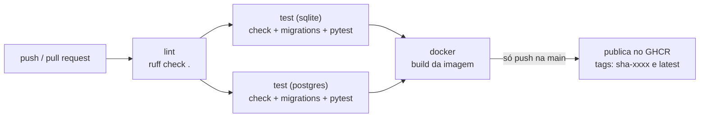
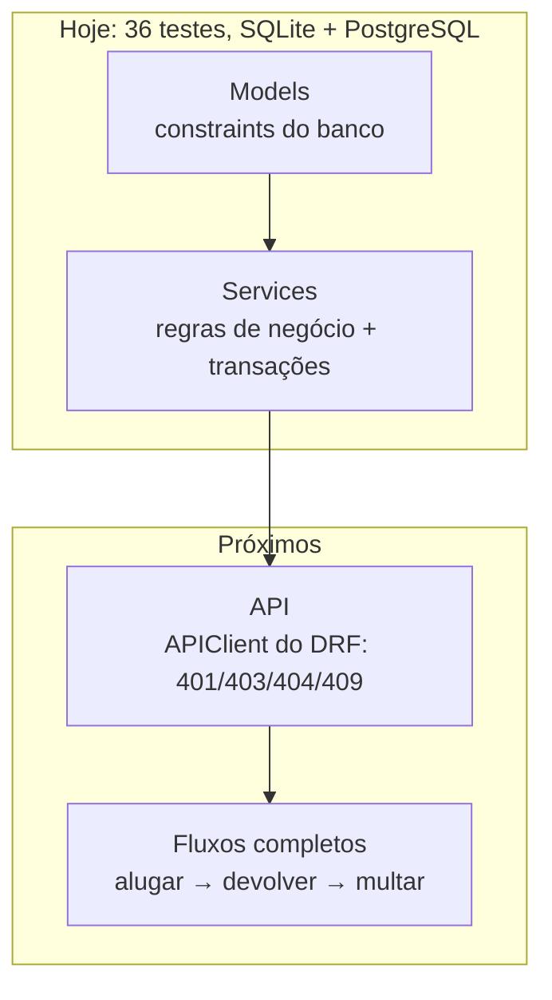

# CI/CD (GitHub Actions)

Arquivo: `.github/workflows/ci.yml`. Roda automaticamente:
- em todo **pull request**;
- em todo **push na `main`**.

## Pipeline



Se uma etapa falha, as seguintes não rodam e o PR aparece com ❌.

## Etapas

### 1. `lint`
Roda `ruff check .`, que procura erros como import não usado, variável indefinida e
sintaxe inválida. As regras estão em `pyproject.toml`.

### 2. `test` (matriz: `sqlite` e `postgres`)
Dois jobs em paralelo, um para cada banco. O PostgreSQL 17 sobe como *service
container* do GitHub. Cada job:
1. instala `requirements-dev.txt` (com cache do pip);
2. `python manage.py check --deploy --fail-level ERROR`: valida a configuração;
3. `python manage.py makemigrations --check --dry-run`: falha se alguém mudou um
   model e esqueceu de gerar a migration;
4. `pytest`: roda os testes com relatório de cobertura.

`fail-fast: false`: se o SQLite falhar, o PostgreSQL continua, para vermos os dois resultados.

### 3. `docker`
Constrói a imagem com o `Dockerfile` (cache do GitHub Actions para ficar rápido).
- Em **pull request**: só constrói, para provar que o build funciona.
- Em **push na `main`**: publica em `ghcr.io/<dono-do-repo>/easycar` com as tags
  `sha-<commit>` e `latest`. Usa o `GITHUB_TOKEN` automático, então não é preciso
  configurar segredo.

## Plano de testes por camada



| Camada | O que testar | Situação |
|---|---|---|
| Models | constraints (UNIQUE, CHECK, um aluguel ativo por carro), PROTECT/CASCADE, tipos, ordenação | ✅ feito (20 testes) |
| Services | carro indisponível, devolução dupla, multa, rollback da transação | ✅ feito (14 testes) |
| Serializers × banco | a constraint nova não atrapalha a validação da API | ✅ feito (2 testes) |
| API | sem login 401, cliente sem permissão 403/404, conflito 409 | pendente |
| Fluxos | alugar → devolver; alugar → multar; excluir carro com aluguel | pendente |

Quando as outras camadas tiverem testes, adicione um mínimo de cobertura no
`pytest.ini` (ex.: `--cov-fail-under=70`) para o CI barrar PR que diminua a cobertura.

## Rodar as mesmas checagens localmente

```bash
ruff check .
python manage.py check
python manage.py makemigrations --check --dry-run
pytest
docker build -t easycar .
```

## Recomendado no GitHub

Em *Settings → Branches → Branch protection rules* para `main`:
- exigir PR para fazer merge;
- exigir que os jobs `lint`, `test (sqlite)`, `test (postgres)` e `docker` passem.
