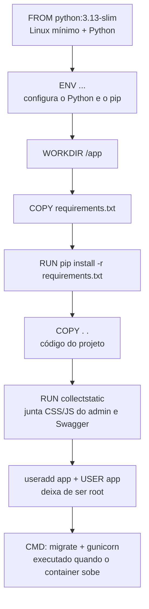
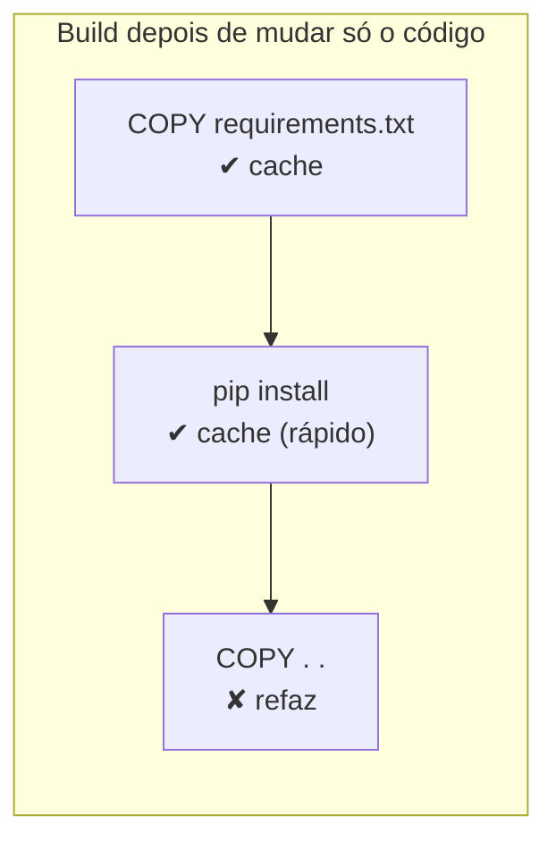
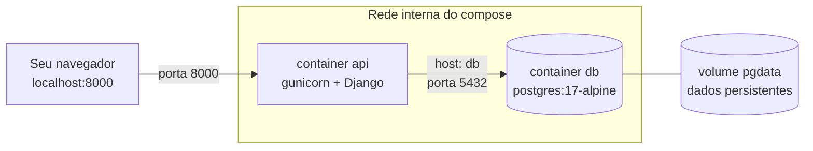
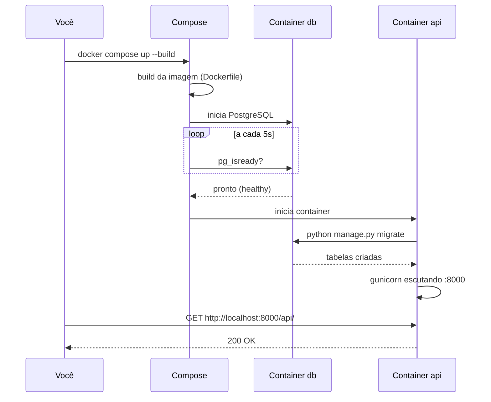

# Docker

O Docker empacota a API com **tudo o que ela precisa** (Python, bibliotecas,
configuração) numa *imagem*. Essa imagem roda igual no PC de qualquer integrante,
no CI e no servidor de produção. Assim acaba o problema do "na minha máquina funciona".

Arquivos envolvidos:

| Arquivo | Função |
|---|---|
| `Dockerfile` | Receita para construir a imagem da API |
| `.dockerignore` | O que **não** entra na imagem (`.env`, `.venv`, `.git`, `db.sqlite3`...) |
| `docker-compose.yml` | Sobe a API **e** o PostgreSQL juntos, já conectados |

---

## 1. Como a imagem é construída (`Dockerfile`)



### Linha a linha

```dockerfile
FROM python:3.13-slim
```
Imagem base oficial do Python 3.13 em Debian "slim" (sem pacotes desnecessários, ~50 MB).

```dockerfile
ENV PYTHONDONTWRITEBYTECODE=1 \
    PYTHONUNBUFFERED=1 \
    PIP_NO_CACHE_DIR=1 \
    PIP_DISABLE_PIP_VERSION_CHECK=1
```
- `PYTHONDONTWRITEBYTECODE=1`: não cria arquivos `.pyc` (inúteis dentro do container).
- `PYTHONUNBUFFERED=1`: o `print`/log aparece na hora em `docker logs`.
- `PIP_NO_CACHE_DIR=1`: o pip não guarda cache, o que deixa a imagem menor.
- `PIP_DISABLE_PIP_VERSION_CHECK=1`: tira o aviso "nova versão do pip".

```dockerfile
WORKDIR /app
COPY requirements.txt .
RUN pip install -r requirements.txt
```
Copia **só** o `requirements.txt` primeiro e instala as dependências. Motivo: o Docker
guarda cada passo em *cache de camadas*. Enquanto o `requirements.txt` não mudar, o
`pip install` (que é o passo demorado) não roda de novo, mesmo que o código mude.



```dockerfile
COPY . .
```
Copia o código. O `.dockerignore` impede que `.env` (segredos), `.venv`, `.git` e
`db.sqlite3` entrem na imagem.

```dockerfile
RUN DJANGO_SECRET_KEY=build-only python manage.py collectstatic --noinput
```
Junta os arquivos estáticos (CSS/JS do Django Admin e do Swagger) em `staticfiles/`.
Com `DEBUG=0` o Django não serve esses arquivos sozinho. Quem serve é o **WhiteNoise**
(middleware configurado no `settings.py`). A `SECRET_KEY` aqui é falsa e só existe
durante o build: o `settings.py` exige uma chave quando `DEBUG=0`.

```dockerfile
RUN useradd --create-home --uid 1000 app && chown -R app /app
USER app
```
Cria um usuário comum e passa a rodar como ele. Se alguém explorar uma falha na
API, não ganha acesso de *root* no container.

```dockerfile
EXPOSE 8000
CMD ["sh", "-c", "python manage.py migrate --noinput && gunicorn config.wsgi:application --bind 0.0.0.0:8000 --workers 3 --access-logfile -"]
```
Quando o container **sobe** (não no build):
1. `migrate` cria/atualiza as tabelas no banco configurado;
2. `gunicorn` inicia o servidor de produção com 3 *workers* (processos) na porta 8000,
   com log de acessos na saída padrão.

> O `runserver` do Django é só para desenvolvimento: ele não aguenta várias
> requisições simultâneas nem é seguro. Em produção usamos o **gunicorn**.

---

## 2. API + banco juntos (`docker-compose.yml`)



- **`db`**: PostgreSQL 17. Os dados ficam no *volume* `pgdata`, então sobrevivem a
  `docker compose down` e só são apagados com `docker compose down -v`.
- **`healthcheck`**: roda `pg_isready` a cada 5 s. A API só sobe quando o banco
  responde (`depends_on: condition: service_healthy`). Sem isso o `migrate` falharia
  porque o Postgres ainda estaria iniciando.
- **`api`**: construída a partir do `Dockerfile`. Usa `DB_ENGINE=postgres` e
  `POSTGRES_HOST=db`: dentro da rede do compose, o nome do serviço vira o endereço.

### Sequência ao rodar `docker compose up --build`



### Comandos úteis

```bash
docker compose up --build            # sobe tudo (Ctrl+C para parar)
docker compose up -d --build         # sobe em segundo plano
docker compose logs -f api           # acompanha os logs da API
docker compose exec api python manage.py createsuperuser   # cria admin
docker compose exec db psql -U easycar -d easycar          # abre o psql no banco
docker compose down                  # para (mantém os dados)
docker compose down -v               # para e APAGA os dados do banco
```

### Validação feita

O build e o compose foram testados localmente:

| Verificação | Resultado |
|---|---|
| Build da imagem | ok (≈ 280 MB) |
| `migrate` no PostgreSQL ao subir | ok |
| `GET /api/` | 200 |
| `GET /static/admin/css/base.css` (WhiteNoise) | 200 |
| `GET /api/carros/` sem login | 401 (protegido) |
| Usuário do processo no container | `app` (não root) |

> ⚠️ As senhas no `docker-compose.yml` (`easycar`/`troque-em-producao`) são **só para
> uso local**. Em produção, defina-as como variáveis/segredos do servidor. Veja
> [banco-de-producao.md](banco-de-producao.md#variáveis-de-ambiente).
