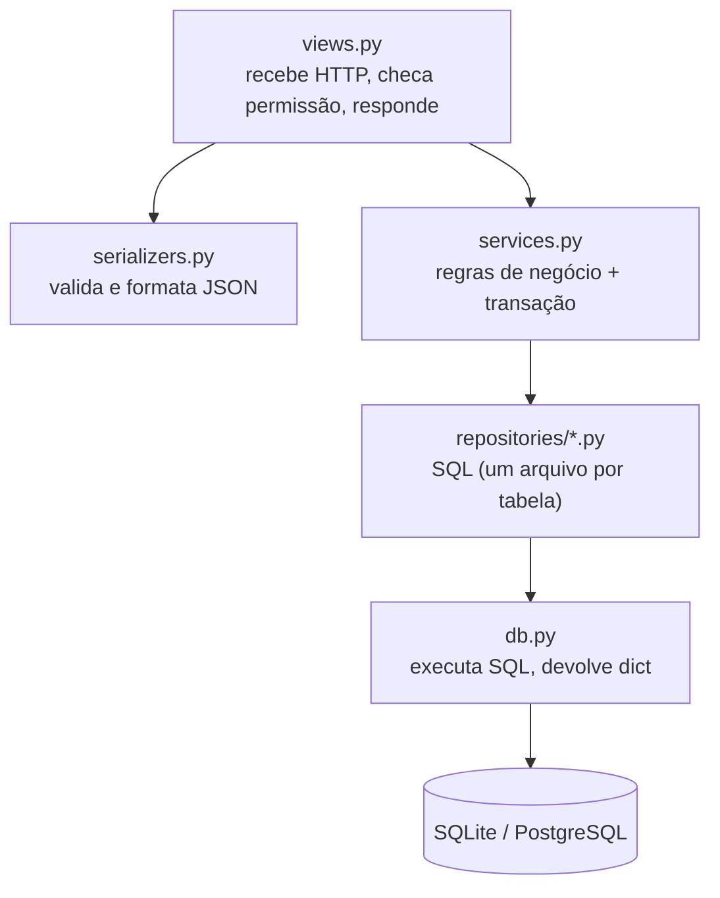
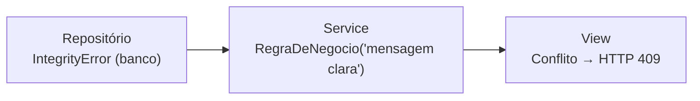

# Padrões de código

## 1. Arquitetura em camadas



| Camada | Pode | Não pode |
|---|---|---|
| `views` | chamar services, serializers, permissões | escrever SQL |
| `services` | regras, `transaction.atomic`, chamar repositórios, lançar `RegraDeNegocio` | conhecer HTTP (status code, request) |
| `repositories` | escrever SQL de **uma** tabela (e JOINs de leitura) | regra de negócio ("pode alugar?") |
| `db.py` | executar SQL e converter resultado | saber de tabelas específicas |

Cada camada só conhece a de baixo. Para trocar o banco, mexemos em `db.py`/repositórios.
Para mudar uma regra, mexemos só no service.

## 2. SQL sem ORM

### Sempre parâmetros, nunca concatenação

```python
# ✅ CERTO: o valor vai separado; o driver escapa
db.buscar_um('SELECT * FROM locadora_carro WHERE placa = %s', [placa])

# ❌ ERRADO: SQL injection. Se placa = "x' OR '1'='1", devolve tudo
db.buscar_um(f"SELECT * FROM locadora_carro WHERE placa = '{placa}'")
```

f-string só é permitida para **nomes fixos do próprio código** (`TABELA`, `COLUNAS`,
nomes de coluna de uma lista fixa), nunca para valores vindos de fora.

### Só SQL que funciona nos dois bancos

| Use | Evite | Motivo |
|---|---|---|
| `%s` | `?` ou `$1` | o Django traduz `%s` para os dois |
| `INSERT ... RETURNING` | `lastrowid` | funciona igual nos dois |
| `db.for_update()` | `FOR UPDATE` direto | não existe no SQLite |
| `LOWER(col) LIKE LOWER(%s)` | `ILIKE` | `ILIKE` é só PostgreSQL |
| `COUNT(*)`, `EXISTS(...)` | funções específicas | portável |
| `db.para_decimal()` ao ler dinheiro | usar o valor cru | SQLite devolve `float`/`int` |

### Colunas explícitas

```python
COLUNAS = 'id, marca, modelo, placa, ano, status'
f'SELECT {COLUNAS} FROM {TABELA}'   # ✅ nunca SELECT *
```
Se alguém adicionar uma coluna na tabela, o código não muda de comportamento sem querer.

### Mudança de status protegida no `WHERE`

```python
"UPDATE locadora_aluguel SET status = 'finalizado' WHERE id = %s AND status = 'ativo'"
# rowcount == 0  →  já estava finalizado (o service transforma em erro 409)
```

### Transações ficam no service

```python
@transaction.atomic            # tudo ou nada
def devolver(aluguel_id: int) -> None:
    if alugueis.finalizar(aluguel_id, timezone.localdate()) == 0:
        raise RegraDeNegocio('Este aluguel já foi finalizado.')
    ...
```

## 3. Type hints

Todo código novo tem **type hints** em parâmetros e retorno.

```python
def buscar_por_id(carro_id: int, bloquear: bool = False) -> CarroLinha | None: ...
```

Padrões adotados:

| Situação | Como tipar |
|---|---|
| Linha de uma tabela | `TypedDict` (ex.: `CarroLinha`, `AluguelLinha`) |
| Valores fixos (status) | `Literal['disponivel', 'alugado', 'manutencao']` |
| Pode não existir | `X \| None` (não `Optional[X]`) |
| Listas/dicts | `list[CarroLinha]`, `dict[str, Any]` (minúsculo, sem `typing.List`) |
| Dinheiro | `Decimal` (nunca `float`) |
| Datas | `datetime.date` |
| Topo do arquivo | `from __future__ import annotations` |

Com `TypedDict`, o editor (VS Code/PyCharm) autocompleta `carro['placa']` e avisa
se digitar `carro['plca']`.

Verificação opcional de tipos:
```bash
pip install mypy django-stubs
mypy locadora/db.py locadora/repositories/
```

## 4. Nomes

| O quê | Padrão | Exemplo |
|---|---|---|
| Idioma | português, sem acento no código | `aluguel`, `data_devolucao` |
| Funções/variáveis | `snake_case`, verbo para ação | `buscar_por_id`, `registrar_pagamento` |
| Classes / TypedDict | `PascalCase` | `CarroLinha`, `RegraDeNegocio` |
| Constantes | `MAIUSCULAS` | `TABELA`, `COLUNAS` |
| Funções de repositório | `listar`, `contar`, `buscar_por_*`, `criar`, `atualizar*`, `excluir`, `tem_*` | — |
| Booleanos | `tem_*`, `eh_*`, `pode_*` | `tem_alugueis`, `eh_funcionario` |

## 5. Erros



- Repositório **não** captura erro: deixa o `IntegrityError` subir.
- Service transforma em `RegraDeNegocio` com uma mensagem para o usuário.
- View converte em resposta HTTP (`409 Conflict`, `404 Not Found`).

## 6. Estilo e ferramentas

- **ruff** para lint (`ruff check .`). Configuração em `pyproject.toml`:
  linhas de até 120 caracteres, aspas simples.
- Docstring curta em toda função pública de repositório/service explicando **o que**
  faz e qualquer pegadinha.
- Um commit por assunto, mensagem no imperativo em português
  (ex.: `Adiciona repositório de multas`).
- Branches: `feature/<assunto>`, `fix/<assunto>`, `docs/<assunto>`. Nada direto na `main`.

## 7. Checklist de PR

- [ ] `ruff check .` sem erros
- [ ] `pytest` passando (SQLite e, se mexeu em SQL, PostgreSQL)
- [ ] SQL com parâmetros `%s` (nada de valor em f-string)
- [ ] Type hints em funções novas
- [ ] Testes para o código novo
- [ ] Mudou model? Gerou migration (`python manage.py makemigrations`)
- [ ] Documentação em `docs/` atualizada se mudou comportamento
