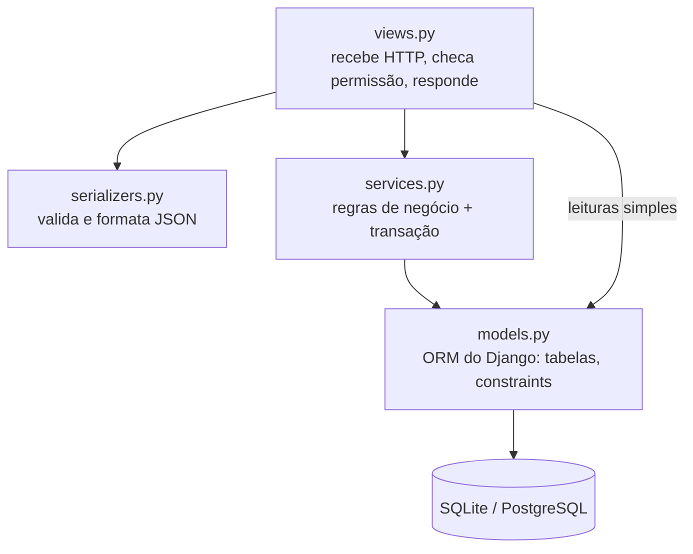
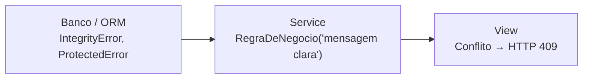

# Padrões de código

## 1. Arquitetura em camadas



| Camada | Responsabilidade | Não deve |
|---|---|---|
| `models.py` | estrutura das tabelas, relações, `constraints`, `indexes`, `ordering`, `__str__` | conter regra que envolva várias tabelas |
| `serializers.py` | validar formato da entrada (placa, CNH, datas) e montar o JSON | mudar status ou gravar em outras tabelas |
| `services.py` | regras que mexem em mais de uma tabela, sempre em `transaction.atomic` | conhecer HTTP (status code, `request`) |
| `views.py` | permissões, escolher o queryset, chamar o service, converter erro em HTTP | ter regra de negócio |

Regra prática: se a operação altera **mais de uma tabela** ou muda um **status**,
ela vai para `services.py`.

## 2. Boas práticas com o ORM

### Regras de dados no model (o banco garante)

```python
class Meta:
    constraints = [
        models.CheckConstraint(condition=models.Q(valor__gt=0), name='aluguel_valor_positivo'),
        models.UniqueConstraint(fields=['carro'], condition=models.Q(status='ativo'),
                                name='aluguel_um_ativo_por_carro'),
    ]
    indexes = [models.Index(fields=['status'], name='aluguel_status_idx')]
```

- Valide **no serializer** (para mensagem amigável) **e** no **model/banco** (para
  garantia). O serializer pode ser pulado (admin, shell, script); o banco, não.
- Nomeie constraints e índices: `<tabela>_<regra>`.

### Sempre pelo ORM, nunca SQL na mão

```python
# ✅ CERTO
Carro.objects.filter(placa=placa)

# ❌ ERRADO: SQL injection se 'placa' vier do usuário
Carro.objects.raw(f"SELECT * FROM locadora_carro WHERE placa = '{placa}'")
```

Se um dia precisar de SQL na mão, use parâmetros:
`Carro.objects.raw('... WHERE placa = %s', [placa])`.

### Evitar N+1 consultas

```python
# ❌ 1 consulta para os aluguéis + 1 por aluguel para o carro + 1 para o cliente...
for a in Aluguel.objects.all():
    print(a.carro.placa, a.perfil_cliente.user.username)

# ✅ tudo em 1 consulta com JOIN
Aluguel.objects.select_related('carro', 'perfil_cliente__user', 'funcionario')
```

- `select_related` para ForeignKey/OneToOne (JOIN).
- `prefetch_related` para "muitos" (ManyToMany, relação reversa).
- O projeto já faz isso em `views.alugueis_completos()`.

### Transações e travas

```python
@transaction.atomic                                     # tudo ou nada
def registrar_aluguel(dados: dict[str, Any], funcionario: User) -> Aluguel:
    carro = Carro.objects.select_for_update().get(pk=dados['carro'].pk)   # trava a linha
    ...
```

- `@transaction.atomic` em todo service que grava em mais de um lugar.
- `select_for_update()` quando ler um valor para decidir e depois gravar
  ("está disponível? então aluga"). Só trava no PostgreSQL.
- Decida com o valor **do banco**, não com o objeto antigo em memória. Use
  `refresh_from_db()` ou releia com `select_for_update()`.

### Gravar só o que mudou

```python
carro.status = Carro.Status.ALUGADO
carro.save(update_fields=['status'])     # UPDATE só da coluna status
```

### Status com `TextChoices`

```python
class Status(models.TextChoices):
    DISPONIVEL = 'disponivel', 'Disponível'
...
if carro.status != Carro.Status.DISPONIVEL:   # ✅ nunca compare com a string solta 'disponivel'
```

### Migrations

1. Alterou um model → `python manage.py makemigrations -n nome_descritivo`.
2. Confira o arquivo gerado e faça commit **junto** com a alteração do model.
3. Nunca edite uma migration que já foi para a `main`: crie uma nova.
4. O CI falha se houver model alterado sem migration (`makemigrations --check`).

## 3. Type hints

Todo código novo tem **type hints** em parâmetros e retorno:

```python
def registrar_multa(
    aluguel: Aluguel,
    funcionario: User,
    *,
    valor: Decimal,
    dias_atrasos: int,
    motivo: str,
    data_infracao: date,
) -> Multa: ...
```

| Situação | Como tipar |
|---|---|
| Instância de model | a própria classe: `Carro`, `Aluguel` |
| Usuário | `User` (`django.contrib.auth.models`) |
| Pode não existir | `X \| None` (não `Optional[X]`) |
| Listas/dicts | `list[Carro]`, `dict[str, Any]` (minúsculo, sem `typing.List`) |
| Dinheiro | `Decimal` (nunca `float`) |
| Datas | `datetime.date` |
| Muitos parâmetros do mesmo tipo | `*` para obrigar nome: `registrar_multa(..., valor=..., motivo=...)` |
| Topo do arquivo | `from __future__ import annotations` |

Verificação opcional de tipos:
```bash
pip install mypy django-stubs
mypy locadora/services.py
```

## 4. Nomes

| O quê | Padrão | Exemplo |
|---|---|---|
| Idioma | português, sem acento no código | `aluguel`, `data_devolucao` |
| Funções/variáveis | `snake_case`, verbo para ação | `registrar_aluguel`, `devolver_carro` |
| Classes | `PascalCase` | `PerfilCliente`, `RegraDeNegocio` |
| Constantes | `MAIUSCULAS` | `GRUPO_FUNCIONARIOS` |
| Funções internas | `_` no início | `_finalizar`, `_travar_aluguel_ativo` |
| Booleanos | `eh_*`, `tem_*`, `pode_*` | `eh_funcionario` |
| Constraints/índices | `<tabela>_<regra>` | `aluguel_valor_positivo`, `carro_status_idx` |

## 5. Erros



- O service transforma erro técnico em `RegraDeNegocio` com uma mensagem para o
  usuário (ex.: `ProtectedError` → "Este aluguel tem multas vinculadas...").
- A view converte `RegraDeNegocio` em resposta HTTP (`409 Conflict`).
- Use `raise ... from erro` para não perder a causa original.

## 6. Testes

- Todo service novo ganha teste em `locadora/tests/test_services.py`.
- Toda constraint nova ganha teste em `locadora/tests/test_models.py`.
- Teste o caminho feliz **e** os erros (carro indisponível, devolução dupla...).
- Detalhes: [banco-de-testes.md](banco-de-testes.md).

## 7. Estilo e ferramentas

- **ruff** para lint (`ruff check .`). Configuração em `pyproject.toml`: linhas de
  até 120 caracteres, aspas simples.
- Docstring curta em toda função de service explicando **o que** faz e as regras.
- Um commit por assunto, mensagem no imperativo em português
  (ex.: `Adiciona constraint de multa`).
- Branches: `feature/<assunto>`, `fix/<assunto>`, `docs/<assunto>`. Nada direto na `main`.

## 8. Checklist de PR

- [ ] `ruff check .` sem erros
- [ ] `pytest` passando (o CI roda em SQLite e PostgreSQL)
- [ ] Mudou model? Gerou migration e fez commit dela
- [ ] Regra que mexe em mais de uma tabela está em `services.py` com `transaction.atomic`
- [ ] Consultas com `select_related`/`prefetch_related` quando usam relações
- [ ] Type hints em funções novas
- [ ] Testes para o código novo
- [ ] Documentação em `docs/` atualizada se mudou comportamento
